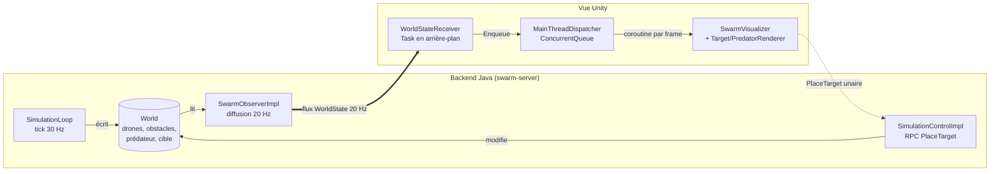

# Gakkel — simulateur d'essaim

> Un système de mission pour drones, qui commence par la recherche d'une épave.
> Ce dépôt contient le backend de simulation (Java) et la vue 3D (Unity).

[](https://github.com/gakkel-labs/swarm-simulator/actions)
[](LICENSE)
[](https://openjdk.org/projects/jdk/21/)

> English version: [`README.md`](README.md)

---

## L'idée

Un avion a disparu en mer. Quelque part dans une zone de 50 à 100 km², son épave
repose sur le fond. **L'opérateur** travaille au centre d'opérations d'un navire de
recherche. Il coordonne plusieurs flottes de drones pour la retrouver, et il ne doit
pas la rater.

Gakkel est le système qui aide l'opérateur à préparer et à suivre ce type de mission.
La recherche d'épave est la mission de référence, mais Gakkel vise toute mission de
drones : inspection, cartographie des fonds (bathymétrie), guerre des mines,
exploration scientifique (prélèvements, pose d'instruments, mesures de l'eau).

Une flotte travaille en quatre temps :

1. **Déposer :** un **porte-drones** dépose un **essaim de drones de détection** dans la zone de recherche.
2. **Détecter :** l'essaim fouille la zone de recherche et trouve les contacts (première détection).
   Le porte-drones parle avec l'essaim et relaie les informations au centre d'opérations.
3. **Confirmer :** le porte-drones déploie ensuite des **drones spécialisés** pour vérifier
   un contact sur place. L'opérateur en donne l'ordre, ou laisse Gakkel le faire automatiquement.
4. **Intervenir :** un drone spécialisé traite le contact confirmé, par exemple il récupère
   la boîte noire ou neutralise une mine.

Plus d'infos sur l'opérateur : [`docs/produit/persona-operateur.fr.md`](docs/produit/persona-operateur.fr.md).

---

## Ce qui marche aujourd'hui

L'étape 1 (une belle scène Unity) est terminée. Aujourd'hui le dépôt contient **seulement la partie essaim** :

- Un **backend Java** simule un essaim de 20 drones en 3D. Les drones se déplacent en
  groupe (règles Boids de Reynolds), évitent des obstacles, restent dans la zone de
  recherche et fuient un prédateur qui les chasse.
- Une **vue Unity** se connecte au backend et affiche l'essaim en direct, au-dessus d'un
  vrai fond marin (bathymétrie de la dorsale de Gakkel). La **vue détaillée** montre des
  modèles 3D (drones, un requin pour le prédateur, une épave, des cheminées hydrothermales) ;
  la **vue simple** (touche V) montre des formes simples. Trois caméras : vue d'ensemble,
  suivi d'un drone, caméra libre.
- Dans la vue, un **clic gauche place une cible** (l'« épave »). Le premier drone qui
  passe à moins de 10 m la détecte : le drone clignote et l'écran affiche quel drone l'a
  trouvée et au bout de combien de secondes.

Ce qui **n'existe pas** encore :

- Pas de porte-drones ni de drones spécialisés (les types sont réservés dans le code et
  le protocole, mais n'ont aucun comportement).
- Les drones ne cherchent pas exprès : ils volent en groupe, et la détection arrive
  quand l'un d'eux passe près de la cible.
- Pas de préparation de mission, pas de poste de contrôle, pas d'optimiseur.

## Le cœur de l'essaim : Boids

Le projet est parti de l'algorithme **Boids**, inventé par Craig Reynolds en 1986 pour
animer des vols d'oiseaux. Il n'y a **pas de chef** : chaque drone regarde seulement ses
voisins proches et suit trois règles simples.

- **Séparation :** ne pas trop s'approcher de ses voisins.
- **Alignement :** aller dans la même direction que ses voisins.
- **Cohésion :** rester près du groupe.

De ces règles locales naît un comportement de groupe. C'est bien adapté à un essaim de
drones : pas de cerveau central, donc perdre un drone n'arrête pas les autres, et
l'essaim reste groupé sans communication lourde. Gakkel ajoute quelques règles :
éviter les obstacles, rester dans la zone de recherche, fuir un prédateur, et un peu
d'errance aléatoire (désactivée par défaut).

Détails, schémas et formules : [`docs/01-boids-rules.fr.md`](docs/01-boids-rules.fr.md).

## Où va le projet

Les prochaines étapes sont suivies dans les jalons (milestones) GitHub :
[Step 1 — Belle scène Unity](https://github.com/gakkel-labs/swarm-simulator/milestone/5),
[Step 2 — Trouver la meilleure configuration de flotte](https://github.com/gakkel-labs/swarm-simulator/milestone/6),
[Step 3 — Saisir la mission sur le web](https://github.com/gakkel-labs/swarm-simulator/milestone/8),
[Step 4 — Rejouer la meilleure configuration dans Unity](https://github.com/gakkel-labs/swarm-simulator/milestone/7),
[Step 5 — Modifier les recommandations et relancer](https://github.com/gakkel-labs/swarm-simulator/milestone/9),
[Step 6 — Suivre la mission](https://github.com/gakkel-labs/swarm-simulator/milestone/10).

Le poste de contrôle de l'opérateur (application web) a son propre dépôt :
[mission-console](https://github.com/gakkel-labs/mission-console). Les rôles sont :
le **poste de contrôle** définit la mission, le **backend Java** lance les simulations et
propose la meilleure configuration de flotte, et **Unity** ne fait qu'afficher : la vue 3D
permettra de suivre une mission en temps réel et de la rejouer ensuite, en voyant les
déplacements des drones. La simulation est une aide, pas une obligation : l'opérateur
peut aussi créer une mission seul, de bout en bout, en choisissant lui-même la
configuration de flotte. Plus tard, l'opérateur pourra aussi créer une **campagne** :
une suite de plusieurs missions, préparées ensemble (voir le
[glossaire](docs/produit/glossaire.fr.md)).

---

## Essayer

### Prérequis

| Outil        | Version              | Notes                                          |
|--------------|----------------------|------------------------------------------------|
| JDK          | 21 (Temurin OK)      | `java -version` doit afficher 21               |
| Maven        | 3.9+                 | `mvn -v`                                       |
| Unity Hub    | avec l'éditeur 6000.4.6f1 (Unity 6) | modèle URP                      |
| Port libre   | `50051` (gRPC)       | Modifiable avec `SWARM_PORT` (voir [Configuration](#configuration)) |

### 1. Lancer le backend

```bash
mvn -pl swarm-server -am package
mvn -pl swarm-server exec:java -Dexec.mainClass="fr.gakkel.swarmsimulator.swarmserver.server.SwarmServer"
```

Vous devez voir :

```
SwarmServer on :50051 — sim 30Hz — stream 20Hz
```

### 2. Ouvrir la vue Unity

1. Dans **Unity Hub**, *Add project from disk* → choisir `unity-client/`.
2. Ouvrir le projet avec **Unity 6 (6000.4.6f1)**.
3. Charger la scène `Assets/Scenes/SampleScene.unity`.
4. Appuyer sur **Play**.

### 3. Résultat attendu

- Des drones apparaissent au-dessus du fond marin et se déplacent en groupe.
- Un prédateur (un requin, ou une sphère rouge en vue simple) les chasse ; les drones proches s'enfuient.
- Clic gauche dans la scène pour placer la cible. Quand un drone passe près d'elle,
  le drone clignote et l'écran affiche « Found by … in …s ».
- Touches : **V** vue détaillée / simple, **B** rochers du fond, **F** caméra de suivi,
  **N** drone suivant, **Tab** caméra libre. Liste complète : [intégration Unity §9](docs/03-unity-integration.fr.md#9-caméras-et-commandes).

Si rien n'apparaît, la cause la plus fréquente est un port gRPC déjà utilisé : arrêter
la JVM précédente ou lancer le backend sur un autre port avec `SWARM_PORT=50052 …`.

---

## Détails techniques

### Architecture

Deux processus indépendants communiquent en gRPC. Le backend est la seule autorité sur
l'état de la simulation ; Unity ne fait que l'afficher.



Pour aller plus loin : [`docs/architecture.fr.md`](docs/architecture.fr.md) (repères,
threads, catalogue des messages).

### Pourquoi ces choix — ADR

- [ADR-0001](docs/adr/0001-grpc-streaming.fr.md) — **gRPC server-streaming** pour
  pousser le WorldState à 20 Hz (plutôt que du polling ou des WebSockets).
- [ADR-0002](docs/adr/0002-no-spring-boot-for-mvp.fr.md) — **Pas de Spring Boot** pour
  le MVP ; `main()` + `ScheduledExecutorService` + `ServerBuilder` suffisent.
- [ADR-0003](docs/adr/0003-minimal-3d-assets.fr.md) — **Assets 3D minimalistes**
  (capsules grises, primitives) pour la première version.
- [ADR-0004](docs/adr/0004-target-placement-operator-triggered.fr.md) — **Cible placée
  par l'opérateur** (clic), branchable plus tard sur une automatisation.
- [ADR-0005](docs/adr/0005-mission-console-replaces-fleet-dashboard.fr.md) —
  **mission-console** remplace l'ancien projet fleet-dashboard.
- [ADR-0006](docs/adr/0006-detailed-and-simple-view.fr.md) — **Vue détaillée et vue simple** :
  modèles 3D pour une démo, formes simples pour l'opérateur (touche V).
- [ADR-0007](docs/adr/0007-coordinate-frames.fr.md) — **Repères** : le backend garde ses
  propres axes, le réseau est en NED, Unity convertit de son côté.
- [ADR-0008](docs/adr/0008-shared-world-concurrency.fr.md) — **Partager le World sans verrou**
  entre le thread de simulation et le thread de diffusion.
- [ADR-0009](docs/adr/0009-storage-and-offline-operation.fr.md) — **Une seule base PostgreSQL tenue
  par le backend**, et une installation qui marche hors ligne sur un poste à bord (proposée).
- [ADR-0010](docs/adr/0010-sorted-drone-list.fr.md) — **Garder les drones triés par id** pour que
  la même graine donne le même résultat, et ne pas optimiser pour l'instant (proposée).
- [ADR-0011](docs/adr/0011-model-assumptions-and-scale.fr.md) — **Une échelle réaliste pour le score** :
  zone de recherche de 7 x 7 km, fiche technique du drone, sonar latéral, voisins par modem
  acoustique ; la démo Unity garde un petit monde (proposée).
- [ADR-0012](docs/adr/0012-loss-risk-replaces-the-predator.fr.md) — **Un risque de perte au lieu
  du prédateur** : l'opérateur choisit un niveau (aucun à extrême), les drones perdus ne
  reviennent pas ; le prédateur reste pour la démo en direct seulement (proposée).

### Configuration

Tous les paramètres sont lus **une seule fois au démarrage**, dans cet ordre :
**variable d'environnement → `application.properties` → valeur par défaut**.

```bash
# exemples
SWARM_PORT=50052 mvn -pl swarm-server exec:java -Dexec.mainClass="…server.SwarmServer"
SWARM_SEED=12345 SWARM_AGENT_COUNT=40 mvn -pl swarm-server exec:java -Dexec.mainClass="…"
```

| Variable | Propriété | Défaut | Rôle |
|----------|-----------|--------|------|
| `SWARM_PORT` | `swarm.port` | `50051` | Port d'écoute gRPC |
| `SWARM_AGENT_COUNT` | `swarm.agent-count` | `20` | Nombre de drones dans l'essaim, si `SWARM_FLEET` n'est pas donné |
| `SWARM_FLEET` | `swarm.fleet` | (vide) | Modèles de drones et leur nombre, par exemple `side-scan-drone:6,fast-drone:4` |
| `SWARM_DRONE_CATALOG` | `swarm.drone-catalog` | `classpath:drone-catalog-demo.json` | Le [catalogue de drones](docs/drone-catalog.fr.md) : un chemin de fichier, ou `classpath:` pour un fichier du jar |
| `SWARM_WORLD_WIDTH` | `swarm.world.width` | `100` | Taille Est–Ouest de la zone de recherche (m) |
| `SWARM_WORLD_HEIGHT` | `swarm.world.height` | `100` | Colonne d'eau, de la surface au fond (m) |
| `SWARM_WORLD_DEPTH` | `swarm.world.depth` | `50` | Taille Nord–Sud de la zone de recherche (m) |
| `SWARM_SEED` | `swarm.seed` | `42` | Graine aléatoire (`random` en tire une et l'écrit dans les logs) |
| `SWARM_PREDATOR_SPEED` | `swarm.predator.speed` | `3.0` | Vitesse du prédateur (m/s), plus lent que les drones |
| `SWARM_PREDATOR_EAT_RADIUS` | `swarm.predator.eat-radius` | `1.5` | Distance à laquelle le prédateur attrape un drone (m) |
| `SWARM_PREDATOR_ENABLED` | `swarm.predator.enabled` | `true` | Affiche le prédateur de la démo en direct (`false` pour le cacher) |
| `SWARM_LOSS_RISK_LEVEL` | `swarm.loss-risk.level` | `none` | Risque de perte : `none`, `low`, `medium`, `high`, `extreme` (0 %, 0,2 %, 2 %, 5 %, 15 % pour 24 h de plongée). Un drone perdu ne revient pas |
| `SWARM_BOIDS_*` | `swarm.boids.*` | (par règle) | Poids et rayons des règles Boids |
| `SWARM_DIAG_*` | `swarm.diag.*` | (par seuil) | Seuils des diagnostics |

La liste complète, avec les valeurs par défaut, est commentée dans
[`swarm-server/src/main/resources/application.properties`](swarm-server/src/main/resources/application.properties).

À propos de la graine : la même graine donne les mêmes positions de départ et les mêmes
tirages aléatoires. Mais la simulation tourne encore sur l'horloge réelle (par exemple
le délai de réapparition après le prédateur), donc deux exécutions peuvent diverger avec
le temps. Une horloge de simulation avec un moteur `step(dt)` est prévue avant
l'optimiseur (étape 2).

### Organisation du dépôt

| Chemin           | Rôle                                                          |
|------------------|---------------------------------------------------------------|
| `contracts/`     | Fichiers `.proto` + stubs Java générés (package `gakkel.swarm.v1`) |
| `swarm-server/`  | Serveur gRPC, modèle métier, boucle de simulation Boids, tests unitaires |
| `tests/`         | Module des tests d'intégration de bout en bout (vide pour l'instant) |
| `unity-client/`  | Projet Unity 6 (6000.4.6f1) / URP — vue 3D                   |
| `docs/`          | Produit, architecture, ADR, notes détaillées, dette technique |

### Stack

- **Backend** — Java 21, Maven 3.9+, grpc-java, protobuf, SLF4J + Logback.
- **Vue** — Unity 6 (6000.4.6f1, URP), client gRPC C#.
- **Tests** — JUnit 5, Mockito, AssertJ (environ 200 tests unitaires et 3 tests de bout en bout dans `tests/`, lancés par la CI
  à chaque push).

### Tests

```bash
# tests unitaires
mvn -pl swarm-server test

# build complet (compilation + tests, tous les modules)
mvn verify
```

### Pour aller plus loin

- [`docs/produit/persona-operateur.fr.md`](docs/produit/persona-operateur.fr.md) — le persona de l'opérateur.
- [`docs/produit/glossaire.fr.md`](docs/produit/glossaire.fr.md) — le glossaire (les mots du projet).
- [`docs/architecture.fr.md`](docs/architecture.fr.md) — flux backend ↔ Unity, threads,
  changement de repère.
- [`docs/01-boids-rules.fr.md`](docs/01-boids-rules.fr.md) — les règles Boids.
- [`docs/02-grpc-contract.fr.md`](docs/02-grpc-contract.fr.md) — référence du protocole.
- [`docs/03-unity-integration.fr.md`](docs/03-unity-integration.fr.md) — pont gRPC
  thread-safe dans Unity, caméras et touches.
- [`docs/04-seabed-bathymetry.fr.md`](docs/04-seabed-bathymetry.fr.md) — le vrai fond marin et ses données.
- [`docs/tech-debt/`](docs/tech-debt/) — instantanés de dette technique.
- [`CONTRIBUTING.fr.md`](CONTRIBUTING.fr.md) — comment contribuer.

---

## Crédits

- Craig W. Reynolds — *Flocks, Herds, and Schools: A Distributed Behavioral Model* (1987).
- Bathymétrie du fond marin : IBCAO 5.2 (Jakobsson et al., 2024, [doi:10.1038/s41597-024-04278-w](https://doi.org/10.1038/s41597-024-04278-w)),
  incluse dans GEBCO Compilation Group (2026) GEBCO 2026 Grid
  (doi : [10.5285/4f68d5c7-45eb-f999e063-7086abc036fa](https://doi.org/10.5285/4f68d5c7-45eb-f999e063-7086abc036fa)),
  domaine public. Pas pour la navigation. Détails : [`docs/04-seabed-bathymetry.fr.md`](docs/04-seabed-bathymetry.fr.md).

## Licence

[PolyForm Noncommercial 1.0.0](https://polyformproject.org/licenses/noncommercial/1.0.0) — voir [`LICENSE`](LICENSE).
Copyright (c) 2026 Bourse Alexandre.

Vous pouvez utiliser, copier et modifier ce projet pour tout usage **non commercial**
(usage personnel, étude, recherche, enseignement, évaluation). Tout usage commercial
nécessite l'autorisation écrite préalable de l'auteur.

Les versions publiées avant ce changement restent disponibles sous licence MIT.
