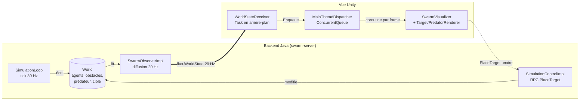

# Gakkel — simulateur d'essaim

> Un système de mission pour drones, qui commence par la recherche d'une épave.
> Ce dépôt contient le backend de simulation (Java) et la vue 3D (Unity).

[](https://github.com/gakkel-labs/swarm-simulator/actions)
[](LICENSE)
[](https://openjdk.org/projects/jdk/21/)

> English version: [`README.md`](README.md)

---

## L'idée

Un avion a disparu en mer. Quelque part dans une zone de 50 à 100 km², son épave
repose sur le fond. **L'opérateur** travaille au centre d'opérations d'un navire de
recherche. Il coordonne plusieurs flottes de drones pour la retrouver, et il ne doit
pas la rater.

Gakkel est le système qui aide l'opérateur à préparer et à suivre ce type de mission.
La recherche d'épave est la mission de référence, mais Gakkel vise toute mission de
drones : inspection, cartographie des fonds, guerre des mines.

Une flotte travaille en trois temps :

1. **Déposer :** un **porte-drones** dépose un **essaim de drones** dans la zone de recherche.
2. **Détecter :** l'essaim fouille la zone et trouve les contacts (première détection).
   Le porte-drones parle avec l'essaim et relaie les informations au centre d'opérations.
3. **Confirmer :** le porte-drones déploie ensuite des **drones spécialisés** pour vérifier
   un contact sur place. L'opérateur en donne l'ordre, ou laisse Gakkel le faire automatiquement.

Plus d'infos sur l'opérateur : [`docs/produit/persona-operateur.fr.md`](docs/produit/persona-operateur.fr.md).

---

## Ce qui marche aujourd'hui

Le projet est à ses débuts. Aujourd'hui le dépôt contient **seulement la partie essaim** :

- Un **backend Java** simule un essaim de 20 drones en 3D. Les drones se déplacent en
  groupe (règles Boids de Reynolds), évitent des obstacles, restent dans la zone et fuient
  un prédateur qui les chasse.
- Une **vue Unity** se connecte au backend et affiche l'essaim en direct (de simples
  capsules grises pour l'instant).
- Dans la vue, un **clic gauche place une cible** (l'« épave »). Le premier drone qui
  passe à moins de 10 m la détecte : le drone clignote et l'écran affiche quel drone l'a
  trouvée et au bout de combien de secondes.

Ce qui **n'existe pas** encore :

- Pas de porte-drones ni de drones spécialisés (les types sont réservés dans le code et
  le protocole, mais n'ont aucun comportement).
- Les drones ne cherchent pas exprès : ils volent en groupe, et la détection arrive
  quand l'un d'eux passe près de la cible.
- Pas de préparation de mission, pas de poste web, pas d'optimiseur.
- Pas encore de vidéo de démo (elle arrive avec l'étape 1).

## Le cœur de l'essaim : Boids

Le projet est parti de l'algorithme **Boids**, inventé par Craig Reynolds en 1986 pour
animer des vols d'oiseaux. Il n'y a **pas de chef** : chaque drone regarde seulement ses
voisins proches et suit trois règles simples.

- **Séparation :** ne pas trop s'approcher de ses voisins.
- **Alignement :** aller dans la même direction que ses voisins.
- **Cohésion :** rester près du groupe.

De ces règles locales naît un comportement de groupe. C'est bien adapté à un essaim de
drones : pas de cerveau central, donc perdre un drone n'arrête pas les autres, et
l'essaim reste groupé sans communication lourde. Gakkel ajoute quelques règles :
éviter les obstacles, rester dans la zone, fuir un prédateur, et un peu d'errance
aléatoire.

Détails, schémas et formules : [`docs/01-boids-rules.fr.md`](docs/01-boids-rules.fr.md).

## Où va le projet

Les prochaines étapes sont suivies dans les jalons (milestones) GitHub :
[Step 1 — Belle scène Unity](https://github.com/gakkel-labs/swarm-simulator/milestone/5),
[Step 2 — Trouver la meilleure configuration de flotte](https://github.com/gakkel-labs/swarm-simulator/milestone/6),
[Step 3 — Rejouer la meilleure configuration dans Unity](https://github.com/gakkel-labs/swarm-simulator/milestone/7),
[Step 4 — Saisir la mission sur le web](https://github.com/gakkel-labs/swarm-simulator/milestone/8),
[Step 5 — Modifier les recommandations et relancer](https://github.com/gakkel-labs/swarm-simulator/milestone/9),
[Step 6 — Suivre la mission](https://github.com/gakkel-labs/swarm-simulator/milestone/10).

Le poste web de l'opérateur a son propre dépôt :
[mission-console](https://github.com/gakkel-labs/mission-console). Les rôles sont :
le **poste web** définit la mission, le **backend Java** lance les simulations et
choisit la meilleure configuration de flotte, et **Unity** ne fait qu'afficher.

---

## Essayer

### Prérequis

| Outil        | Version              | Notes                                          |
|--------------|----------------------|------------------------------------------------|
| JDK          | 21 (Temurin OK)      | `java -version` doit afficher 21               |
| Maven        | 3.9+                 | `mvn -v`                                       |
| Unity Hub    | avec l'éditeur 6000.4.6f1 (Unity 6) | modèle URP                      |
| Port libre   | `50051` (gRPC)       | Modifiable avec `SWARM_PORT` (voir [Configuration](#configuration)) |

### 1. Lancer le backend

```bash
mvn -pl swarm-server -am package
mvn -pl swarm-server exec:java -Dexec.mainClass="fr.gakkel.swarmsimulator.swarmserver.server.SwarmServer"
```

Vous devez voir :

```
SwarmServer on :50051 — sim 30Hz — stream 20Hz
```

### 2. Ouvrir la vue Unity

1. Dans **Unity Hub**, *Add project from disk* → choisir `unity-client/`.
2. Ouvrir le projet avec **Unity 6 (6000.4.6f1)**.
3. Charger la scène `Assets/Scenes/SampleScene.unity`.
4. Appuyer sur **Play**.

### 3. Résultat attendu

- Des capsules grises apparaissent et se déplacent en groupe.
- Un prédateur rouge traverse la zone ; les capsules proches s'enfuient.
- Clic gauche dans la scène pour placer la cible. Quand une capsule passe près d'elle,
  la capsule clignote et l'écran affiche « Found by … in …s ».

Si rien n'apparaît, la cause la plus fréquente est un port gRPC déjà utilisé : arrêter
la JVM précédente ou lancer le backend sur un autre port avec `SWARM_PORT=50052 …`.

---

## Détails techniques

### Architecture

Deux processus indépendants communiquent en gRPC. Le backend est la seule autorité sur
l'état de la simulation ; Unity ne fait que l'afficher.



Pour aller plus loin : [`docs/architecture.fr.md`](docs/architecture.fr.md) (repères
NED↔Unity, modèle de threads, catalogue des messages).

### Pourquoi ces choix — ADR

- [ADR-0001](docs/adr/0001-grpc-streaming.fr.md) — **gRPC server-streaming** pour
  pousser le WorldState à 20 Hz (plutôt que du polling ou des WebSockets).
- [ADR-0002](docs/adr/0002-no-spring-boot-for-mvp.fr.md) — **Pas de Spring Boot** pour
  le MVP ; `main()` + `ScheduledExecutorService` + `ServerBuilder` suffisent.
- [ADR-0003](docs/adr/0003-minimal-3d-assets.fr.md) — **Assets 3D minimalistes**
  (capsules grises, primitives) pour la première version.
- [ADR-0004](docs/adr/0004-target-placement-operator-triggered.fr.md) — **Cible placée
  par l'opérateur** (clic), branchable plus tard sur une automatisation.
- [ADR-0005](docs/adr/0005-mission-console-replaces-fleet-dashboard.fr.md) —
  **mission-console** remplace l'ancien projet fleet-dashboard.

### Configuration

Tous les paramètres sont lus **une seule fois au démarrage**, dans cet ordre :
**variable d'environnement → `application.properties` → valeur par défaut**.

```bash
# exemples
SWARM_PORT=50052 mvn -pl swarm-server exec:java -Dexec.mainClass="…server.SwarmServer"
SWARM_SEED=12345 SWARM_AGENT_COUNT=40 mvn -pl swarm-server exec:java -Dexec.mainClass="…"
```

| Variable | Propriété | Défaut | Rôle |
|----------|-----------|--------|------|
| `SWARM_PORT` | `swarm.port` | `50051` | Port d'écoute gRPC |
| `SWARM_AGENT_COUNT` | `swarm.agent-count` | `20` | Nombre de drones dans l'essaim |
| `SWARM_WORLD_WIDTH` | `swarm.world.width` | `100` | Taille du monde en X |
| `SWARM_WORLD_HEIGHT` | `swarm.world.height` | `100` | Taille du monde en Y |
| `SWARM_WORLD_DEPTH` | `swarm.world.depth` | `50` | Taille du monde en Z |
| `SWARM_SEED` | `swarm.seed` | `42` | Graine aléatoire (`random` en tire une et l'écrit dans les logs) |
| `SWARM_BOIDS_*` | `swarm.boids.*` | (par règle) | Poids et rayons des règles Boids |
| `SWARM_DIAG_*` | `swarm.diag.*` | (par seuil) | Seuils des diagnostics |

La liste complète, avec les valeurs par défaut, est commentée dans
[`swarm-server/src/main/resources/application.properties`](swarm-server/src/main/resources/application.properties).

À propos de la graine : la même graine donne les mêmes positions de départ et les mêmes
tirages aléatoires. Mais la simulation tourne encore sur l'horloge réelle (par exemple
le délai de réapparition après le prédateur), donc deux exécutions peuvent diverger avec
le temps. Une horloge de simulation avec un moteur `step(dt)` est prévue avant
l'optimiseur (étape 2).

### Organisation du dépôt

| Chemin           | Rôle                                                          |
|------------------|---------------------------------------------------------------|
| `contracts/`     | Fichiers `.proto` + stubs Java générés (package `gakkel.swarm.v1`) |
| `swarm-server/`  | Serveur gRPC, modèle métier, boucle de simulation Boids, tests unitaires |
| `tests/`         | Module des tests d'intégration de bout en bout (vide pour l'instant) |
| `unity-client/`  | Projet Unity 6 (6000.4.6f1) / URP — vue 3D                   |
| `docs/`          | Produit, architecture, ADR, notes détaillées, dette technique |

### Stack

- **Backend** — Java 21, Maven 3.9+, grpc-java, protobuf, SLF4J + Logback.
- **Vue** — Unity 6 (6000.4.6f1, URP), client gRPC C#.
- **Tests** — JUnit 5, Mockito, AssertJ (environ 170 tests unitaires, lancés par la CI
  à chaque push).

### Tests

```bash
# tests unitaires
mvn -pl swarm-server test

# build complet (compilation + tests, tous les modules)
mvn verify
```

### Pour aller plus loin

- [`docs/produit/persona-operateur.fr.md`](docs/produit/persona-operateur.fr.md) — le persona de l'opérateur.
- [`docs/produit/glossaire.fr.md`](docs/produit/glossaire.fr.md) — le glossaire (les mots du projet).
- [`docs/architecture.fr.md`](docs/architecture.fr.md) — flux backend ↔ Unity, threads,
  changement de repère.
- [`docs/01-boids-rules.fr.md`](docs/01-boids-rules.fr.md) — les règles Boids.
- [`docs/02-grpc-contract.fr.md`](docs/02-grpc-contract.fr.md) — référence du protocole.
- [`docs/03-unity-integration.fr.md`](docs/03-unity-integration.fr.md) — pont gRPC
  thread-safe dans Unity.
- [`docs/tech-debt/`](docs/tech-debt/) — instantanés de dette technique.
- [`CONTRIBUTING.md`](CONTRIBUTING.md) — comment contribuer.

---

## Crédits

- Craig W. Reynolds — *Flocks, Herds, and Schools: A Distributed Behavioral Model* (1987).

## Licence

[PolyForm Noncommercial 1.0.0](https://polyformproject.org/licenses/noncommercial/1.0.0) — voir [`LICENSE`](LICENSE).
Copyright (c) 2026 Bourse Alexandre.

Vous pouvez utiliser, copier et modifier ce projet pour tout usage **non commercial**
(usage personnel, étude, recherche, enseignement, évaluation). Tout usage commercial
nécessite l'autorisation écrite préalable de l'auteur.

Les versions publiées avant ce changement restent disponibles sous licence MIT.
