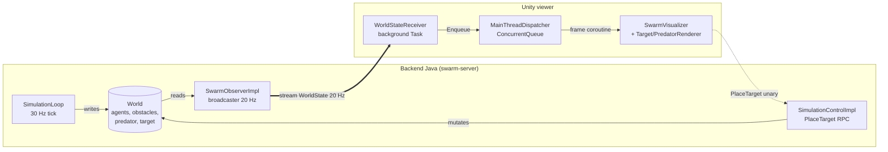

# Gakkel — swarm simulator

> A drone mission system, starting with the search for a sunken wreck.
> This repository holds the simulation backend (Java) and the 3D viewer (Unity).

[](https://github.com/gakkel-labs/swarm-simulator/actions)
[](LICENSE)
[](https://openjdk.org/projects/jdk/21/)

> Version française : [`README.fr.md`](README.fr.md)

---

## The idea

An aircraft has disappeared at sea. Somewhere in an area of 50 to 100 km², its wreck
lies on the seabed. **The operator** works in the operations centre of a research
vessel. They coordinate several drone fleets to find it, and they must not miss it.

Gakkel is the system that helps the operator prepare and follow this kind of mission.
The wreck search is the reference mission, but Gakkel is meant for any drone mission:
inspection, seabed mapping, mine countermeasures.

A fleet works in four steps:

1. **Drop:** a **drone carrier** drops a **swarm of detection drones** in the search area.
2. **Detect:** the swarm searches the area and finds the contacts (first detection).
   The drone carrier talks to the swarm and relays the information to the operations centre.
3. **Confirm:** the drone carrier then deploys **specialised drones** to check a contact
   on site. The operator gives the order, or lets Gakkel do it automatically.
4. **Intervene:** a specialised drone takes care of the confirmed contact, for example
   recovers the black box or neutralises a mine.

More about the operator: [`docs/produit/persona-operateur.md`](docs/produit/persona-operateur.md).

---

## What works today

This is an early stage. Today the repository contains **the swarm part only**:

- A **Java backend** simulates a swarm of 20 drones in 3D. The drones move as a group
  (Reynolds' Boids rules), avoid obstacles, stay inside the area and flee a predator
  that hunts them.
- A **Unity viewer** connects to the backend and shows the swarm live (simple grey
  capsules for now).
- In the viewer, a **left-click places a target** (the "wreck"). The first drone that
  passes within 10 m of it detects it: the drone blinks and the screen shows which drone
  found it and after how many seconds.

What does **not** exist yet:

- No drone carrier and no specialised drones (the types are reserved in the code and the
  protocol, but have no behaviour).
- The drones do not search on purpose: they flock, and detection happens when one of
  them passes near the target.
- No mission planning, no web station, no optimizer.
- No demo video yet (it comes with Step 1).

## The heart of the swarm: Boids

The project started from the **Boids** algorithm, invented by Craig Reynolds in 1986 to
animate flocks of birds. There is **no leader**: each drone only looks at its close
neighbours and follows three simple rules.

- **Separation:** don't get too close to your neighbours.
- **Alignment:** go in the same direction as your neighbours.
- **Cohesion:** stay close to the group.

From these local rules, a group behaviour emerges. This suits a drone swarm well: no
central brain, so losing one drone does not stop the others, and the swarm stays
together without heavy communication. Gakkel adds a few rules on top: avoid obstacles,
stay inside the area, flee a predator, and a little random wandering.

Details, diagrams and formulas: [`docs/01-boids-rules.md`](docs/01-boids-rules.md).

## Where the project goes

The next steps are tracked as GitHub milestones:
[Step 1 — Beautiful Unity scene](https://github.com/gakkel-labs/swarm-simulator/milestone/5),
[Step 2 — Find the best fleet configuration](https://github.com/gakkel-labs/swarm-simulator/milestone/6),
[Step 3 — Play the best configuration in Unity](https://github.com/gakkel-labs/swarm-simulator/milestone/7),
[Step 4 — Enter the mission on the web](https://github.com/gakkel-labs/swarm-simulator/milestone/8),
[Step 5 — Edit the recommendations and rerun](https://github.com/gakkel-labs/swarm-simulator/milestone/9),
[Step 6 — Follow the mission](https://github.com/gakkel-labs/swarm-simulator/milestone/10).

The operator's web station lives in its own repository:
[mission-console](https://github.com/gakkel-labs/mission-console). The roles are:
the **web station** defines the mission, the **Java backend** runs the simulations and
chooses the best fleet configuration, and **Unity** only displays.

---

## Try it

### Prerequisites

| Tool         | Version              | Notes                                          |
|--------------|----------------------|------------------------------------------------|
| JDK          | 21 (Temurin OK)      | `java -version` should report 21               |
| Maven        | 3.9+                 | `mvn -v`                                       |
| Unity Hub    | with Editor 6000.4.6f1 (Unity 6) | URP template                       |
| Free port    | `50051` (gRPC)       | Override with `SWARM_PORT` (see [Configuration](#configuration)) |

### 1. Start the backend

```bash
mvn -pl swarm-server -am package
mvn -pl swarm-server exec:java -Dexec.mainClass="fr.gakkel.swarmsimulator.swarmserver.server.SwarmServer"
```

You should see:

```
SwarmServer on :50051 — sim 30Hz — stream 20Hz
```

### 2. Open the Unity viewer

1. In **Unity Hub**, *Add project from disk* → select `unity-client/`.
2. Open the project with **Unity 6 (6000.4.6f1)**.
3. Load the scene `Assets/Scenes/SampleScene.unity`.
4. Hit **Play**.

### 3. Expected result

- Grey capsules appear and move as a group.
- A red predator moves through the area; nearby capsules flee.
- Left-click in the scene to place the target. When a capsule passes close to it, the
  capsule blinks and the screen shows "Found by … in …s".

If nothing appears, the most common cause is the gRPC port already being used: stop the
previous JVM or start the backend on another port with `SWARM_PORT=50052 …`.

---

## Technical details

### Architecture

Two independent processes talk over gRPC. The backend is the only authority on the
simulation state; Unity only displays it.



Deeper dive: [`docs/architecture.md`](docs/architecture.md) (NED↔Unity frame
remapping, thread model, message catalogue).

### Why these choices — ADRs

- [ADR-0001](docs/adr/0001-grpc-streaming.md) — **gRPC server-streaming** to push
  WorldState at 20 Hz (vs. polling or WebSockets).
- [ADR-0002](docs/adr/0002-no-spring-boot-for-mvp.md) — **No Spring Boot** for the MVP;
  `main()` + `ScheduledExecutorService` + `ServerBuilder` is enough.
- [ADR-0003](docs/adr/0003-minimal-3d-assets.md) — **Minimal 3D assets** (grey capsules,
  primitives) for the first version.
- [ADR-0004](docs/adr/0004-target-placement-operator-triggered.md) — **Target placed by
  the operator** (click), pluggable for later automation.
- [ADR-0005](docs/adr/0005-mission-console-replaces-fleet-dashboard.md) —
  **mission-console** replaces the old fleet-dashboard project.

### Configuration

All runtime parameters are read **once at startup**, in this order:
**environment variable → `application.properties` → built-in default**.

```bash
# examples
SWARM_PORT=50052 mvn -pl swarm-server exec:java -Dexec.mainClass="…server.SwarmServer"
SWARM_SEED=12345 SWARM_AGENT_COUNT=40 mvn -pl swarm-server exec:java -Dexec.mainClass="…"
```

| Variable | Property | Default | Meaning |
|----------|----------|---------|---------|
| `SWARM_PORT` | `swarm.port` | `50051` | gRPC listen port |
| `SWARM_AGENT_COUNT` | `swarm.agent-count` | `20` | Number of drones in the swarm |
| `SWARM_WORLD_WIDTH` | `swarm.world.width` | `100` | World X extent |
| `SWARM_WORLD_HEIGHT` | `swarm.world.height` | `100` | World Y extent |
| `SWARM_WORLD_DEPTH` | `swarm.world.depth` | `50` | World Z extent |
| `SWARM_SEED` | `swarm.seed` | `42` | RNG seed (`random` draws one and logs it) |
| `SWARM_BOIDS_*` | `swarm.boids.*` | (per rule) | Boids weights and radii |
| `SWARM_DIAG_*` | `swarm.diag.*` | (per threshold) | Diagnostics thresholds |

The full list, with defaults, is commented in
[`swarm-server/src/main/resources/application.properties`](swarm-server/src/main/resources/application.properties).

About the seed: the same seed gives the same starting positions and the same random
choices. The simulation still runs on the real clock (for example the respawn delay
after the predator), so two runs can drift apart over time. A simulation clock with a
`step(dt)` engine is planned before the optimizer (Step 2).

### Repository layout

| Path             | Role                                                          |
|------------------|---------------------------------------------------------------|
| `contracts/`     | `.proto` files + generated Java stubs (package `gakkel.swarm.v1`) |
| `swarm-server/`  | gRPC server, domain model, Boids simulation loop, unit tests  |
| `tests/`         | Module for end-to-end integration tests (empty for now)       |
| `unity-client/`  | Unity 6 (6000.4.6f1) / URP project — 3D viewer               |
| `docs/`          | Product, architecture, ADRs, deep dives, tech-debt snapshots  |

### Stack

- **Backend** — Java 21, Maven 3.9+, grpc-java, protobuf, SLF4J + Logback.
- **Viewer** — Unity 6 (6000.4.6f1, URP), gRPC C# client.
- **Tests** — JUnit 5, Mockito, AssertJ (about 170 unit tests, run by CI on every push).

### Tests

```bash
# unit tests
mvn -pl swarm-server test

# full build (compile + tests, all modules)
mvn verify
```

### Going further

- [`docs/produit/persona-operateur.md`](docs/produit/persona-operateur.md) — the operator persona.
- [`docs/produit/glossaire.md`](docs/produit/glossaire.md) — the glossary (the words of the project).
- [`docs/architecture.md`](docs/architecture.md) — backend ↔ Unity flow, threading,
  frame remapping.
- [`docs/01-boids-rules.md`](docs/01-boids-rules.md) — the Boids rules.
- [`docs/02-grpc-contract.md`](docs/02-grpc-contract.md) — wire protocol reference.
- [`docs/03-unity-integration.md`](docs/03-unity-integration.md) — thread-safe gRPC
  bridge in Unity.
- [`docs/tech-debt/`](docs/tech-debt/) — tech-debt snapshots.
- [`CONTRIBUTING.md`](CONTRIBUTING.md) — how to contribute.

---

## Credits

- Craig W. Reynolds — *Flocks, Herds, and Schools: A Distributed Behavioral Model* (1987).

## License

[PolyForm Noncommercial 1.0.0](https://polyformproject.org/licenses/noncommercial/1.0.0) — see [`LICENSE`](LICENSE).
Copyright (c) 2026 Bourse Alexandre.

You may use, copy and modify this project for any **noncommercial** purpose
(personal use, study, research, teaching, evaluation). Commercial use requires
prior written permission from the author.

Versions published before this change remain available under the MIT license.
