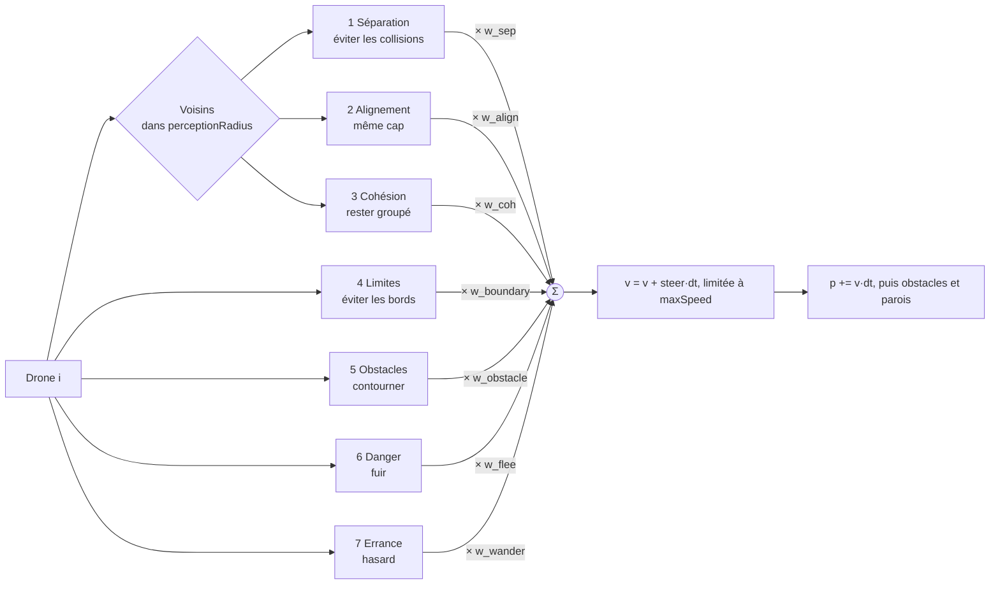

# Boids — les 3 règles de Reynolds et les 4 règles ajoutées par Gakkel

[English](01-boids-rules.md)

> Le cœur de la simulation : comment chaque drone décide où aller.
> Référence : **Reynolds, C. W. (1987)** — *« Flocks, herds, and schools: A distributed behavioral model »*, SIGGRAPH '87, p. 25–34.

---

## 1. Vue d'ensemble

À chaque tick, chaque drone (un **boid**) applique les **3 règles de Reynolds** (séparation,
alignement, cohésion) et **4 règles ajoutées par Gakkel** pour son environnement : rester dans la
zone de recherche, éviter les obstacles, fuir le danger, et errer un peu. Chaque règle donne un
vecteur. Les vecteurs sont pondérés, additionnés, puis appliqués à la vitesse.

**Principe clé :** un drone ne voit que ses **voisins proches**, dans un rayon de perception
unique (`perceptionRadius`). Pas de vue globale, pas de chef. Le comportement de groupe naît de
ces règles locales simples.

> Dans le code, un drone est un `Agent` et le danger est un `Predator` (ancien nom, à renommer).
> Toutes les règles sont dans [`BoidsRules.java`](../swarm-server/src/main/java/fr/gakkel/swarmsimulator/swarmserver/domain/BoidsRules.java).

| # | Règle | Code | Reynolds ? | Sortie |
|---|-------|------|------------|--------|
| 1 | Séparation | `separation` | oui | vecteur unitaire |
| 2 | Alignement | `alignment` | oui | vecteur unitaire |
| 3 | Cohésion | `cohesion` | oui | vecteur unitaire |
| 4 | Répulsion des limites | `boundaryRepulsion` | non | vecteur unitaire |
| 5 | Évitement des obstacles | `obstacleAvoidance` | non | **non normalisé** |
| 6 | Fuite du danger | `predatorFlee` | non | **non normalisé** |
| 7 | Errance | `wander` | non | vecteur unitaire (désactivée par défaut) |

---

## 2. Schéma des règles



Seules les règles 1 à 3 utilisent la liste des voisins. Les règles 4 à 7 regardent le monde
(parois, obstacles, danger) ou rien du tout (errance).

---

## 3. Règle 1 — Séparation

**But :** ne pas trop s'approcher de ses voisins.

**Principe :** chaque voisin repousse le drone. La poussée part du voisin, et sa force vaut
**1/d** : un voisin deux fois plus proche pousse deux fois plus fort. Le résultat est normalisé.

```text
fonction separation(agent, voisins):
    si voisins est vide : retourner (0, 0, 0)
    somme = (0, 0, 0)
    pour chaque n dans voisins:                # tous les voisins dans perceptionRadius
        away = agent.position - n.position
        d = |away|
        si d > ε:
            somme += away / d²                 # = unitaire(away) / d → force 1/d
    retourner normaliser(somme)                # (0, 0, 0) si la somme est nulle
```

> Tous les voisins perçus sont pris en compte, pas seulement les très proches. Un voisin au bord
> de `perceptionRadius` (25 m) pousse 25 fois moins qu'un voisin à 1 m.

---

## 4. Règle 2 — Alignement

**But :** aller dans la même direction que ses voisins.

**Principe :** additionner les vitesses des voisins et retourner la direction de la somme.

```text
fonction alignment(voisins):
    si voisins est vide : retourner (0, 0, 0)
    somme = Σ n.vitesse
    retourner normaliser(somme)                # (0, 0, 0) si les vitesses s'annulent
```

---

## 5. Règle 3 — Cohésion

**But :** rester près du groupe.

**Principe :** calculer le **centroïde** (le centre) des voisins et retourner la direction vers lui.

```text
fonction cohesion(agent, voisins):
    si voisins est vide : retourner (0, 0, 0)
    centroïde = (Σ n.position) / nombre(voisins)
    retourner normaliser(centroïde - agent.position)
```

---

## 6. Règle 4 — Répulsion des limites *(ajoutée par Gakkel)*

**But :** garder les drones dans la zone de recherche simulée. Le modèle de Reynolds pur ne dit
pas ce qui se passe au bord.

**Principe :** pour chacune des 6 parois, si le drone est plus près que `boundaryRepulsionRadius`,
la paroi le repousse avec une force de **1/d** (d = distance à la paroi). La somme est normalisée.

```text
fonction boundaryRepulsion(agent, monde):
    poussée = (0, 0, 0)
    pour chaque paroi:                          # x : 0 / width, y : -height / 0, z : 0 / depth
        d = distance de l'agent à la paroi
        si ε ≤ d < boundaryRepulsionRadius:
            poussée += normale_vers_l_intérieur / d
    retourner normaliser(poussée)
```

Sur l'axe vertical, le monde va de `-height` (fond) à `0` (surface) : voir
l'[ADR-0007](adr/0007-coordinate-frames.fr.md).

---

## 7. Règle 5 — Évitement des obstacles *(ajoutée par Gakkel)*

**But :** contourner les obstacles (des sphères pour l'instant).

**Principe :** pour chaque obstacle, `gap` est la distance entre le drone et la surface de la
sphère. Si `gap < obstacleAvoidanceRadius`, l'obstacle repousse le drone loin de son centre avec
une force de **e^(−5 · gap / rayon)** : 1 à la surface, environ 0,007 au bord du rayon. Le
résultat n'est **pas normalisé** : la poussée grandit en douceur quand le drone s'approche.

```text
fonction obstacleAvoidance(agent, obstacles):
    total = (0, 0, 0)
    pour chaque o dans obstacles:
        delta = agent.position - o.position
        d = |delta|
        gap = d - o.rayon
        si d < ε ou gap ≥ obstacleAvoidanceRadius : continuer
        force = exp(-5 · max(gap, 0) / obstacleAvoidanceRadius)
        total += unitaire(delta) · force
    retourner total                             # NON normalisé
```

Si un drone finit quand même dans une sphère, la boucle de simulation le remet sur la surface et
retire la partie de sa vitesse qui va vers l'intérieur (`resolveObstacleCollision`).

---

## 8. Règle 6 — Fuite du danger *(ajoutée par Gakkel)*

**But :** fuir le danger quand il s'approche. Le danger est un seul objet qui bouge, pas un
voisin : il est traité à part de la liste des voisins.

**Principe :** dans `threatFleeRadius`, le danger repousse le drone avec une force de **1/d**.
Le résultat n'est **pas normalisé** : avec `threatFleeWeight = 200`, la fuite l'emporte sur
toutes les autres règles quand le danger est à quelques mètres. Hors du rayon, la force est nulle.

```text
fonction predatorFlee(agent, danger):
    away = agent.position - danger.position
    d = |away|
    si d > threatFleeRadius ou d < ε : retourner (0, 0, 0)
    retourner away / d²                         # = unitaire(away) / d, NON normalisé
```

Le danger lui-même (`Predator`) va tout droit vers le drone le plus proche à 3 m/s (par défaut). S'il passe à
moins de 1,5 m, il attrape le drone : le drone est retiré, puis revient 5 s plus tard, à au moins
30 m du danger.

---

## 9. Règle 7 — Errance *(ajoutée par Gakkel)*

**But :** un petit mouvement au hasard, pour que l'essaim n'ait pas l'air mécanique, et pour
qu'un groupe arrêté puisse repartir.

**Principe :** un vecteur unitaire au hasard, tiré d'un générateur avec graine (la même graine
donne le même début d'exécution). Son poids `wanderWeight` vaut **0 par défaut** : la règle est
éteinte tant qu'on ne le règle pas (`SWARM_BOIDS_WANDER_WEIGHT`).

---

## 10. Composition et déplacement

```text
steer = w_sep      · separation(agent, voisins)
      + w_align    · alignment(voisins)
      + w_coh      · cohesion(agent, voisins)
      + w_boundary · boundaryRepulsion(agent, monde)
      + w_obstacle · obstacleAvoidance(agent, obstacles)
      + w_flee     · predatorFlee(agent, danger)      # seulement s'il y a un danger
      + w_wander   · wander()

v = limiter(v + steer · dt, maxSpeed)                 # la seule limite
p = p + v · dt
pour chaque obstacle : si p est dedans, remettre p sur la surface et retirer la vitesse vers l'intérieur
si p dépasse une paroi : mettre à 0 la vitesse vers cette paroi, puis ramener p dans le monde
```

Tous les vecteurs d'un tick sont calculés **d'abord**, à partir de la même copie de la liste des
drones, et c'est seulement ensuite que les drones bougent. L'ordre des drones ne change pas le
résultat.

---

## 11. Coefficients et leur effet

Valeurs par défaut (`BoidsConfig`). Chacune peut être changée au démarrage par une variable
d'environnement `SWARM_BOIDS_*` ou une propriété `swarm.boids.*` (voir le [README](../README.fr.md#configuration)).

| Paramètre                  | Défaut            | Rôle                                                            | Effet si on l'augmente                       |
| -------------------------- | ----------------- | --------------------------------------------------------------- | -------------------------------------------- |
| `perceptionRadius`         | `25.0` m          | Rayon dans lequel un drone voit ses voisins (règles 1–3)        | Voisinage plus large, comportement plus global |
| `separationWeight`         | `1.8`             | Poids de la séparation                                          | Essaim plus lâche, plus d'espace             |
| `alignmentWeight`          | `1.5`             | Poids de l'alignement                                           | Mouvement plus parallèle, effet « banc »     |
| `cohesionWeight`           | `1.5`             | Poids de la cohésion                                            | Essaim plus serré                            |
| `boundaryRepulsionRadius`  | `15.0` m          | Distance à une paroi en dessous de laquelle elle repousse       | Marge plus grande aux bords                  |
| `boundaryRepulsionWeight`  | `2.0`             | Poids de la répulsion des limites                               | Les drones tournent plus tôt avant les parois |
| `obstacleAvoidanceRadius`  | `8.0` m           | Écart à la surface d'une sphère en dessous duquel elle repousse | Les drones contournent de plus loin          |
| `obstacleAvoidanceWeight`  | `4.0`             | Poids de l'évitement des obstacles                              | Virages plus larges autour des obstacles     |
| `threatFleeRadius`         | `15.0` m          | Distance à laquelle un drone fuit le danger                     | Zone de panique plus large                   |
| `threatFleeWeight`         | `200.0`           | Poids de la fuite du danger                                     | Panique plus forte                           |
| `wanderWeight`             | `0.0`             | Poids de l'errance (0 = éteinte)                                | Plus de hasard, moins mécanique              |
| `maxSpeed`                 | `5.0` m/s         | Vitesse maximale d'un drone                                     | Essaim plus rapide et plus réactif           |
| `dt` *(boucle)*            | `1/30 s ≈ 33 ms`  | Pas de temps (30 Hz)                                            | Pas plus grands → moins stable               |

Le danger a ses propres réglages : vitesse 3 m/s (`SWARM_PREDATOR_SPEED`) et rayon de capture
1,5 m (`SWARM_PREDATOR_EAT_RADIUS`), tous deux dans `PredatorConfig`. Autres valeurs fixes (dans
le code, pas encore réglables) : rayon du capteur 10 m (`SimulationConstants.SENSOR_RADIUS_M`),
retour après 5 s à au moins 30 m du danger (`SimulationLoop`).

**Repères :**
- `w_sep` un peu plus grand que `w_align` et `w_coh` → pas de collision, l'essaim tient.
- `boundaryRepulsionWeight` > `cohesionWeight` → rester dans la zone de recherche passe avant rester groupé.
- Un `perceptionRadius` plus grand sans changer les poids fait agir l'essaim comme un seul bloc.

---

## 12. Limites connues

| Limite                    | Description                                                                 | État / piste                                                  |
| ------------------------- | --------------------------------------------------------------------------- | ------------------------------------------------------------- |
| **Dépassement**           | Un drone dépasse le centroïde et revient. Le terme `desired − velocity` de Reynolds l'amortirait, mais il n'est pas utilisé (voir §13.1). | Ouvert. Pilotage Reynolds (§14) ou terme d'amortissement.    |
| **Oscillation**           | Au repos, des forces opposées font trembler un drone autour d'un point.     | Ouvert. Une petite zone morte sur la vitesse est possible.    |
| **Essaim coupé**          | L'essaim peut se couper en groupes stables qui ne se rejoignent plus.      | En partie : l'errance (règle 7) existe mais est éteinte par défaut. |
| **Coût O(N²)**            | À chaque tick, chaque drone regarde tous les autres pour trouver ses voisins. | Ouvert. Grille spatiale ou octree quand l'essaim grandira.  |
| **Pas de but**            | L'essaim bouge mais ne va nulle part exprès : la détection arrive par hasard. | Ouvert. Des schémas de recherche sont prévus (voir le [glossaire](produit/glossaire.fr.md)). |
| **Obstacles sphériques**  | Les obstacles sont des sphères pour le serveur, dessinées en cheminées dans Unity (ADR-0006). | Ouvert : issue #142 (vraies formes, par exemple une colonne). |
| **Pas de temps**          | `p += v·dt` devient instable avec un grand `dt`.                            | OK : `dt` est fixé à 33 ms.                                   |
| **Horloge réelle**        | La boucle suit l'horloge de l'ordinateur : deux exécutions avec la même graine divergent. | Ouvert : horloge de simulation `step(dt)` prévue à l'étape 2. |

---

## 13. Choix qui diffèrent du modèle de Reynolds pur

### 13.1 Les règles retournent une direction, pas une force de pilotage

Reynolds construit une force de pilotage complète dans chaque règle :

```
desired = normaliser(desired) · MAX_SPEED
steer   = limiter(desired − agent.vitesse, MAX_FORCE)
```

Ici, les règles 1 à 4 et 7 retournent une **direction unitaire**. Les poids et l'intégration se
font ailleurs, dans `steer()` et la boucle de simulation. Diviser par `n` avant de normaliser
n'est pas utile : la direction ne change pas.

**Pourquoi :** chaque règle dit *où aller*, pas *comment accélérer*. Chaque règle se teste seule,
sans vitesse courante.

### 13.2 Un seul rayon pour toutes les règles

Reynolds utilise deux rayons : un petit pour la séparation et un plus grand pour l'alignement et
la cohésion. Ici il n'y a qu'un `perceptionRadius` ; la force 1/d de la séparation fait déjà que
les voisins lointains poussent très peu.

### 13.3 Pas de MAX_FORCE

Reynolds limite chaque force de pilotage à `MAX_FORCE`. Ici, les règles 1–4 retournent des
vecteurs unitaires : leur part de la somme vaut au plus `1,8 + 1,5 + 1,5 + 2,0 = 6,8`. Les
règles 5 et 6 ne sont pas bornées, exprès (elles doivent gagner quand le drone va heurter
quelque chose). La seule limite est `maxSpeed` sur la vitesse.

### 13.4 Quatre règles ajoutées

Répulsion des limites, évitement des obstacles, fuite du danger et errance ne sont pas dans le
modèle à 3 règles. La méthode `steer(agent, voisins)` sans `world` (visibilité package) garde la
somme pure des 3 règles pour les tests unitaires.

| Choix | Reynolds pur | Gakkel | Raison |
|---|---|---|---|
| Sortie d'une règle | `desired − velocity`, limitée | direction unitaire (règles 1–4, 7) | Chaque règle testée seule |
| Rayons | 2 | 1 (`perceptionRadius`) | Un seul paramètre à régler |
| MAX_FORCE | oui | non ; seulement `maxSpeed` | Les vecteurs unitaires sont déjà bornés |
| Environnement | non traité | 4 règles ajoutées | Parois, obstacles, danger, errance |

---

## 14. Revenir au Reynolds pur

Un refactoring mécanique de `BoidsConfig` (ajouter `separationRadius` et `maxForce`), de
`BoidsRules` (appliquer `normaliser · maxSpeed − vitesse` puis `limiter(maxForce)` dans les
règles 1–3) et de `BoidsRulesTest`. Coût principal : régler à nouveau les poids, car le
comportement change.

Ce que cela apporterait :
- **Ralentissement naturel** : le terme `desired − velocity` amortit le dépassement et l'oscillation.
- **Rayon de virage réglable** : `maxForce / maxSpeed`.
- **Comportement d'arrivée** : un drone qui va vers un point de passage peut ralentir avant.
  Utile quand les vrais schémas de recherche arriveront.
- **Un test de sûreté de plus** : `steer` borné par `maxForce`.

Ce qui ne changerait pas : les 4 règles ajoutées, le coût O(N²), le comportement de groupe.

**Recommandation :** le faire avant d'ajouter des points de passage ou des schémas de recherche
(étape 2 ou plus tard).

---

## 15. Tests et références

- Tests unitaires : `BoidsRulesTest.java` teste chaque règle seule ; `SimulationLoopTest.java`
  teste le déplacement, les obstacles et les parois.
- **Reynolds, C. W.** (1987). *Flocks, herds and schools: A distributed behavioral model.*
  SIGGRAPH '87, p. 25–34. [DOI : 10.1145/37401.37406](https://doi.org/10.1145/37401.37406)
  (souvent daté de 1986, l'année d'envoi).
- Reynolds, C. W. — [Boids — Background and Update](https://www.red3d.com/cwr/boids/).
