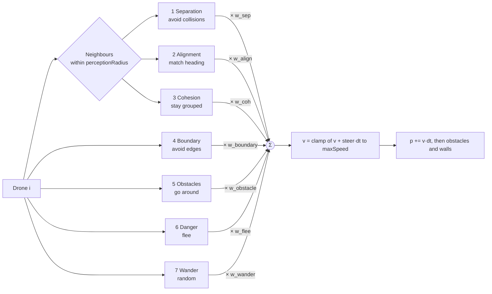

# Boids — Reynolds' 3 rules and the 4 rules added by Gakkel

[Français](01-boids-rules.fr.md)

> The heart of the simulation: how each drone decides where to go.
> Reference: **Reynolds, C. W. (1987)** — *"Flocks, herds, and schools: A distributed behavioral model"*, SIGGRAPH '87, pp. 25–34.

---

## 1. Overview

Every tick, each drone (a **boid**) applies **Reynolds' 3 rules** (separation, alignment,
cohesion) and **4 rules added by Gakkel** for its environment: stay inside the search area,
avoid obstacles, flee the danger, and wander a little. Each rule gives a vector. The vectors are
weighted, summed, then applied to the velocity.

**Key principle:** a drone only sees its **close neighbours**, within one perception radius
(`perceptionRadius`). No global knowledge, no leader. The group behaviour comes from these
simple local rules.

> In the code, a drone is an `Agent` and the danger is a `Predator` (old name, to be renamed).
> All rules are in [`BoidsRules.java`](../swarm-server/src/main/java/fr/gakkel/swarmsimulator/swarmserver/domain/BoidsRules.java).

| # | Rule | Code | Reynolds? | Output |
|---|------|------|-----------|--------|
| 1 | Separation | `separation` | yes | unit vector |
| 2 | Alignment | `alignment` | yes | unit vector |
| 3 | Cohesion | `cohesion` | yes | unit vector |
| 4 | Boundary repulsion | `boundaryRepulsion` | no | unit vector |
| 5 | Obstacle avoidance | `obstacleAvoidance` | no | **not normalized** |
| 6 | Danger flee | `predatorFlee` | no | **not normalized** |
| 7 | Wander | `wander` | no | unit vector (off by default) |

---

## 2. Schema of the rules



Only rules 1 to 3 use the neighbour list. Rules 4 to 7 look at the world (walls, obstacles,
danger) or at nothing (wander).

---

## 3. Rule 1 — Separation

**Goal:** don't get too close to your neighbours.

**Principle:** each neighbour pushes the drone away. The push points away from the neighbour and
its strength is **1/d**: a neighbour twice as close pushes twice as hard. The result is
normalized.

```text
function separation(agent, neighbours):
    if neighbours is empty: return (0, 0, 0)
    sum = (0, 0, 0)
    for each n in neighbours:                  # all neighbours within perceptionRadius
        away = agent.position - n.position
        d = |away|
        if d > ε:
            sum += away / d²                   # = unit(away) / d → strength 1/d
    return normalize(sum)                      # (0, 0, 0) if sum is zero
```

> All perceived neighbours are used, not only the very close ones. A neighbour at the edge of
> `perceptionRadius` (25 m) pushes 25 times less than one at 1 m.

---

## 4. Rule 2 — Alignment

**Goal:** go in the same direction as your neighbours.

**Principle:** add the neighbours' velocities, and return the direction of the sum.

```text
function alignment(neighbours):
    if neighbours is empty: return (0, 0, 0)
    sum = Σ n.velocity
    return normalize(sum)                      # (0, 0, 0) if the velocities cancel out
```

---

## 5. Rule 3 — Cohesion

**Goal:** stay close to the group.

**Principle:** compute the **centroid** (the centre) of the neighbours, and return the
direction towards it.

```text
function cohesion(agent, neighbours):
    if neighbours is empty: return (0, 0, 0)
    centroid = (Σ n.position) / count(neighbours)
    return normalize(centroid - agent.position)
```

---

## 6. Rule 4 — Boundary repulsion *(added by Gakkel)*

**Goal:** keep the drones inside the simulated search area. The pure Reynolds model does not
say what happens at the edge.

**Principle:** for each of the 6 walls, if the drone is closer than `boundaryRepulsionRadius`,
the wall pushes it back with a strength of **1/d** (d = distance to the wall). The sum is
normalized.

```text
function boundaryRepulsion(agent, world):
    push = (0, 0, 0)
    for each wall:                              # x: 0 / width, y: -height / 0, z: 0 / depth
        d = distance from agent to the wall
        if ε ≤ d < boundaryRepulsionRadius:
            push += wall_inward_normal / d
    return normalize(push)
```

On the vertical axis, the world goes from `-height` (seabed) to `0` (surface): see
[ADR-0007](adr/0007-coordinate-frames.md).

---

## 7. Rule 5 — Obstacle avoidance *(added by Gakkel)*

**Goal:** go around the obstacles (spheres for now).

**Principle:** for each obstacle, `gap` is the distance between the drone and the sphere
surface. If `gap < obstacleAvoidanceRadius`, the obstacle pushes the drone away from its centre
with a strength of **e^(−5 · gap / radius)**: 1 at the surface, about 0.007 at the edge of the
radius. The result is **not normalized**, so the push grows smoothly as the drone gets closer.

```text
function obstacleAvoidance(agent, obstacles):
    total = (0, 0, 0)
    for each o in obstacles:
        delta = agent.position - o.position
        d = |delta|
        gap = d - o.radius
        if d < ε or gap ≥ obstacleAvoidanceRadius: continue
        strength = exp(-5 · max(gap, 0) / obstacleAvoidanceRadius)
        total += unit(delta) · strength
    return total                                # NOT normalized
```

If a drone still ends up inside a sphere, the simulation loop puts it back on the surface and
removes the part of its velocity that goes inwards (`resolveObstacleCollision`).

---

## 8. Rule 6 — Danger flee *(added by Gakkel)*

**Goal:** flee the danger when it comes close. The danger is one moving object, not a
neighbour, so it is handled apart from the neighbour list.

**Principle:** inside `threatFleeRadius`, the danger pushes the drone away with a strength of
**1/d**. The result is **not normalized**: with `threatFleeWeight = 200`, the flee wins over all
the other rules when the danger is a few metres away. Outside the radius, the force is zero.

```text
function predatorFlee(agent, danger):
    away = agent.position - danger.position
    d = |away|
    if d > threatFleeRadius or d < ε: return (0, 0, 0)
    return away / d²                            # = unit(away) / d, NOT normalized
```

The danger itself (`Predator`) goes straight to the nearest drone at 3 m/s (by default). If it gets closer
than 1.5 m, it catches the drone: the drone is removed, then comes back 5 s later, at least 30 m
away from the danger.

---

## 9. Rule 7 — Wander *(added by Gakkel)*

**Goal:** a little random movement, so the swarm does not look mechanical, and so a group that
has stopped can move again.

**Principle:** a random unit vector, drawn from a seeded random generator (the same seed gives
the same run start). Its weight `wanderWeight` is **0 by default**: the rule is off until it is
set (`SWARM_BOIDS_WANDER_WEIGHT`).

---

## 10. Composition and movement

```text
steer = w_sep      · separation(agent, neighbours)
      + w_align    · alignment(neighbours)
      + w_coh      · cohesion(agent, neighbours)
      + w_boundary · boundaryRepulsion(agent, world)
      + w_obstacle · obstacleAvoidance(agent, obstacles)
      + w_flee     · predatorFlee(agent, danger)      # only if there is a danger
      + w_wander   · wander()

v = clamp(v + steer · dt, maxSpeed)                     # the only limit
p = p + v · dt
for each obstacle: if p is inside, put p back on the surface and remove the inward velocity
if p is past a wall: set the velocity towards that wall to 0, then clamp p inside the world
```

All the steering vectors of a step are computed **first**, from the same copy of the drone
list, and only then are the drones moved. So no drone sees a neighbour that has already moved.

The order still matters a little: the wander force draws its random numbers drone after drone,
and with floating-point numbers, adding the same values in another order can change the last
digits. This is why the world keeps its drones **sorted by id**.

**Determinism rules** (same seed, same result, bit for bit):

- One simulation = one seed. Everything random in it comes from generators built from that seed,
  including the drone ids.
- A random generator is never shared between two simulations or two threads.
- Same order every time: drones by id, no loop over a `HashMap` or `HashSet`, no parallel sums.
- Time comes from the simulation clock (`SimulationClock`), never from the computer's clock.

The test `SimulationTest.Reproducibility` checks these rules: the same seed run twice gives
strictly equal positions and velocities after 30 s, danger included.

---

## 11. Coefficients and their effect

Default values (`BoidsConfig`). Each one can be changed at start with an environment variable
`SWARM_BOIDS_*` or a `swarm.boids.*` property (see the [README](../README.md#configuration)).

| Parameter                  | Default           | Role                                                            | Effect if increased                          |
| -------------------------- | ----------------- | --------------------------------------------------------------- | -------------------------------------------- |
| `perceptionRadius`         | `25.0` m          | Radius in which a drone sees its neighbours (rules 1–3)         | Larger neighbourhood, more global behaviour  |
| `separationWeight`         | `1.8`             | Weight of separation                                            | Looser swarm, larger spacing                 |
| `alignmentWeight`          | `1.5`             | Weight of alignment                                             | More parallel motion, "school" effect        |
| `cohesionWeight`           | `1.5`             | Weight of cohesion                                              | Tighter, more compact swarm                  |
| `boundaryRepulsionRadius`  | `15.0` m          | Distance from a wall below which it pushes                      | Larger safety margin at the edges            |
| `boundaryRepulsionWeight`  | `2.0`             | Weight of boundary repulsion                                    | Drones turn away from walls earlier          |
| `obstacleAvoidanceRadius`  | `8.0` m           | Gap to a sphere surface below which it pushes                   | Drones go around obstacles from further away |
| `obstacleAvoidanceWeight`  | `4.0`             | Weight of obstacle avoidance                                    | Wider turns around obstacles                 |
| `threatFleeRadius`         | `15.0` m          | Distance at which a drone flees the danger                      | Wider panic zone                             |
| `threatFleeWeight`         | `200.0`           | Weight of the danger flee                                       | Stronger panic response                      |
| `wanderWeight`             | `0.0`             | Weight of wander (0 = off)                                      | More random, less mechanical                 |
| `dt` *(simulation loop)*   | `1/30 s ≈ 33 ms`  | Time step (30 Hz)                                               | Larger steps → less stable                   |

The danger has its own settings: speed 3 m/s (`SWARM_PREDATOR_SPEED`) and catch radius 1.5 m
(`SWARM_PREDATOR_EAT_RADIUS`), both in `PredatorConfig`. The speed limit (5 m/s) and
the detection radius (10 m) of a drone are not Boids settings: they come from its drone
specification in the [drone catalog](drone-catalog.md) (#176). Other fixed values (in the code,
not configurable yet): respawn after 5 s at least 30 m from the danger (`Simulation`). The 5 s are simulation time, not real time.

**Rules of thumb:**
- `w_sep` a little higher than `w_align` and `w_coh` → no collisions, the swarm still holds.
- `boundaryRepulsionWeight` > `cohesionWeight` → staying inside wins over staying grouped.
- A larger `perceptionRadius` without new weights makes the swarm act as one block.

---

## 12. Known limits

| Limit                     | Description                                                                 | Status / way out                                              |
| ------------------------- | --------------------------------------------------------------------------- | ------------------------------------------------------------- |
| **Overshooting**          | A drone goes past the centroid and comes back. The `desired − velocity` term of pure Reynolds would damp this, but it is not used (see §13.1). | Open. Reynolds steering (§14) or a damping term.              |
| **Oscillation**           | At rest, opposite forces make a drone shake around a point.                 | Open. A small dead zone on the velocity is possible.          |
| **Split swarm**           | The swarm can split into stable groups that never meet again.               | Partly: wander (rule 7) exists but is off by default.         |
| **O(N²) cost**            | Each tick, each drone looks at all the others to find its neighbours.       | Open. Spatial grid or octree when the swarm gets bigger.      |
| **No goal**               | The swarm moves but goes nowhere on purpose: detection happens by chance.  | Open. Search patterns are planned (see the [glossary](produit/glossaire.md)). |
| **Sphere obstacles**      | Obstacles are spheres for the server, drawn as chimneys in Unity (ADR-0006).| Open: issue #142 (real shapes such as a column).              |
| **Time step**             | `p += v·dt` becomes unstable with a large `dt`.                             | Fine: `dt` is fixed at 33 ms.                                 |
| **Wall clock**            | The loop follows the computer clock, so two runs with the same seed drift apart. | Open: simulation clock `step(dt)` planned for Step 2.     |

---

## 13. Choices that differ from the pure Reynolds model

### 13.1 Rules return a direction, not a steering force

Reynolds builds a full steering force inside each rule:

```
desired = normalize(desired) · MAX_SPEED
steer   = clamp(desired − agent.velocity, MAX_FORCE)
```

Here, rules 1 to 4 and 7 return a **unit direction**. Weights and integration happen outside,
in `steer()` and the simulation loop. Dividing by `n` before normalizing is not needed: the
direction does not change.

**Why:** each rule says *where to go*, not *how to accelerate*. Each rule can be tested on its
own, without a current velocity.

### 13.2 One radius for all rules

Reynolds uses two radii: a small one for separation and a larger one for alignment and
cohesion. Here there is one `perceptionRadius`; the 1/d strength of separation already makes
far neighbours push very little.

### 13.3 No MAX_FORCE

Reynolds caps each steering force at `MAX_FORCE`. Here, rules 1–4 return unit vectors, so their
part of the sum is at most `1.8 + 1.5 + 1.5 + 2.0 = 6.8`. Rules 5 and 6 are not bounded on
purpose (they must win when the drone is about to hit something). The only cap is `maxSpeed`
on the velocity.

### 13.4 Four rules added

Boundary repulsion, obstacle avoidance, danger flee and wander are not in the 3-rule model.
The `steer(agent, neighbours)` method without `world` (package-private) keeps the pure
3-rule sum for unit tests.

| Choice | Pure Reynolds | Gakkel | Reason |
|---|---|---|---|
| Rule output | `desired − velocity`, clamped | unit direction (rules 1–4, 7) | Each rule tested on its own |
| Radii | 2 | 1 (`perceptionRadius`) | One parameter to tune |
| MAX_FORCE | yes | no; `maxSpeed` only | Unit vectors are already bounded |
| Environment | not handled | 4 added rules | Walls, obstacles, danger, wander |

---

## 14. Going back to pure Reynolds

A mechanical refactor of `BoidsConfig` (add `separationRadius` and `maxForce`), `BoidsRules`
(apply `normalize · maxSpeed − velocity` then `clamp(maxForce)` in rules 1–3) and
`BoidsRulesTest`. Main cost: tuning the weights again, because the behaviour changes.

What it would bring:
- **Natural slowing down**: the `desired − velocity` term damps overshooting and oscillation.
- **Turning radius you can tune**: `maxForce / maxSpeed`.
- **Arrival behaviour**: a drone going to a waypoint can slow down before it. Useful when real
  search patterns arrive.
- **One more safety test**: `steer` bounded by `maxForce`.

What would not change: the 4 added rules, the O(N²) cost, the global flocking.

**Recommendation:** do it before adding waypoints or search patterns (Step 2 or later).

---

## 15. Tests and references

- Unit tests: `BoidsRulesTest.java` tests each rule on its own; `SimulationTest.java` tests
  the movement, the obstacles, the walls, the respawn and the target detection.
- **Reynolds, C. W.** (1987). *Flocks, herds and schools: A distributed behavioral model.*
  SIGGRAPH '87, pp. 25–34. [DOI: 10.1145/37401.37406](https://doi.org/10.1145/37401.37406)
  (often dated 1986, the year it was sent).
- Reynolds, C. W. — [Boids — Background and Update](https://www.red3d.com/cwr/boids/).
