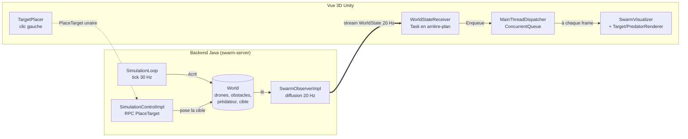
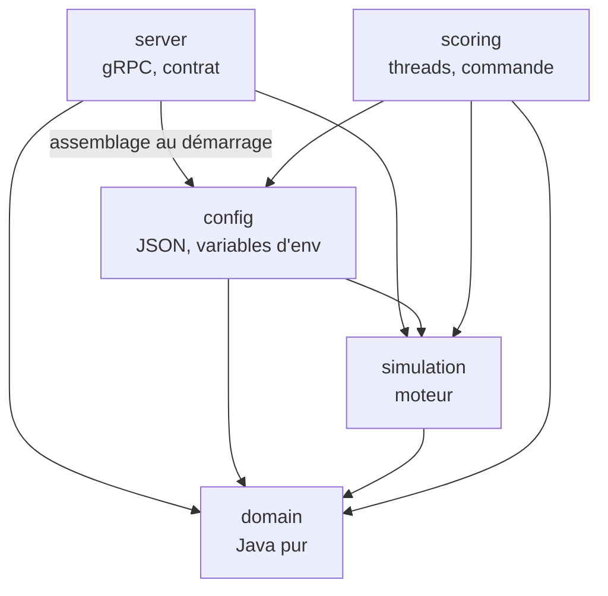
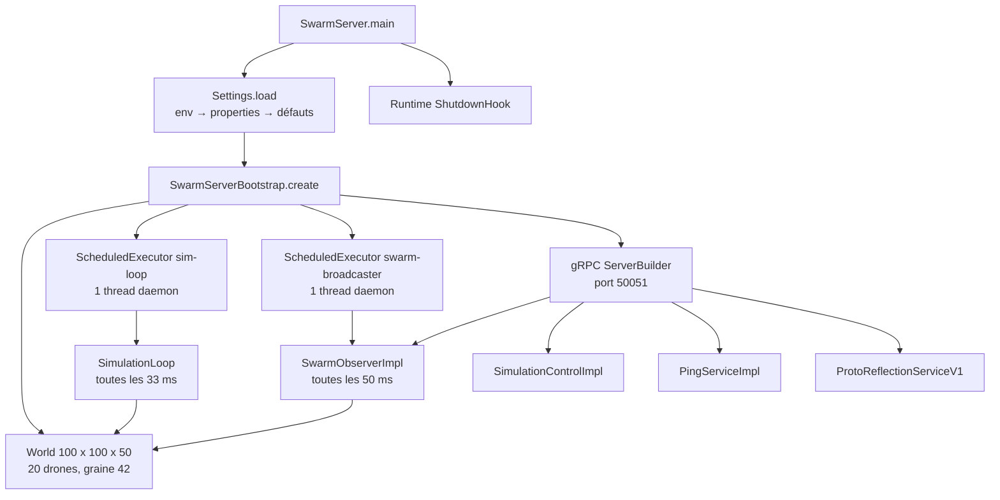
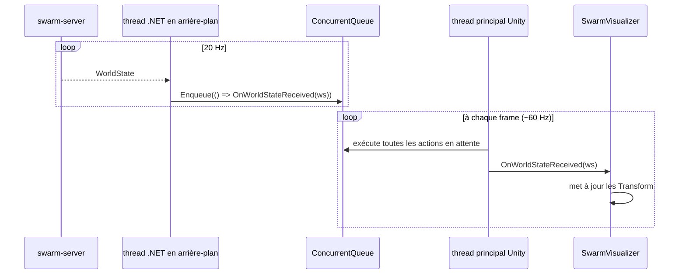

# Architecture : simulateur d'essaim Gakkel

[English](architecture.md)

> Comment le backend Java et la vue 3D Unity travaillent ensemble aujourd'hui (fin de l'étape 1).

---

## 1. Vue d'ensemble

Deux processus indépendants parlent par **gRPC** :

- **Backend Java** (`swarm-server`) : la seule autorité sur la simulation. Il tient le monde,
  applique les règles Boids à 30 Hz et envoie un `WorldState` 20 fois par seconde.
- **Vue 3D Unity** (`unity-client`) : affichage seulement. Elle reçoit le `WorldState` et
  déplace les drones à l'écran. Elle envoie une seule commande : `PlaceTarget`, quand l'opérateur clique.



Pourquoi ce découpage : [ADR-0001 : gRPC streaming](adr/0001-grpc-streaming.fr.md),
[ADR-0002 : pas de Spring Boot](adr/0002-no-spring-boot-for-mvp.fr.md),
[ADR-0003 : assets 3D minimaux](adr/0003-minimal-3d-assets.fr.md) et
[ADR-0006 : vue détaillée et vue simple](adr/0006-detailed-and-simple-view.fr.md).

Le poste de contrôle de l'opérateur (web) vivra dans son propre dépôt,
[mission-console](https://github.com/gakkel-labs/mission-console), à partir de l'étape 4
([ADR-0005](adr/0005-mission-console-replaces-fleet-dashboard.fr.md)).

---

## 2. Découpage en modules

### Backend : Maven multi-modules

`pom.xml` racine (`fr.gakkel.swarmsimulator:swarm-simulator:0.1-SNAPSHOT`, packaging `pom`) avec 3 modules :

| Module          | Rôle                                               | Dépend de      |
|-----------------|----------------------------------------------------|----------------|
| `contracts/`    | Fichiers `.proto` + stubs Java générés (proto3)    | —              |
| `swarm-server/` | Serveur gRPC, domaine, boucle de simulation Boids  | `contracts`    |
| `tests/`        | Tests de bout en bout (`SwarmServerEndToEndTest` : vrai serveur sur un port libre, vrai client gRPC) | `swarm-server` |

Versions principales dans le POM racine : Java **21**, gRPC **1.81.0**, Protobuf **3.25.5**,
JUnit **5.10.2**, Mockito **5.23.0**, SLF4J **2.0.13**, Logback **1.5.32**.

### Backend : packages

```
fr.gakkel.swarmsimulator.swarmserver
├── config         # Settings (serveur), ScoringSettings (lu au lancement d'un scoring) : variables d'env →
│                  # application.properties → défauts
├── domain         # Agent, AgentType, World, Vector3D, LossRiskLevel, Predator (démo seulement), PredatorConfig,
│                  # Motion (position + vitesse), Target, Obstacle, TriggerSource, BoidsConfig, BoidsRules,
│                  # Scenario, EndConditions, SimulationEvent (événements de domaine), SearchArea, Mission
├── simulation     # Simulation (le moteur), SimulationProfile, SimulationResult, Scoring, DemoOptions,
│                  # WorldFactory, SimulationLoop, SimulationService,
│                  # SimulationConstants, FlockingDiagnostician,
│                  # DiagnosticsConfig, CohesionMetric (dispersion sur fenêtre glissante), CohesionCsvExporter
├── scoring        # ParallelScoring (simulations côte à côte, sur leurs propres threads), ScoringCommand (main)
└── server         # SwarmServer (main), SwarmServerBootstrap (assemblage), SwarmObserverImpl,
                   # SimulationControlImpl, PingServiceImpl, WorldStateBuilder, CoordinateConversions
```

Le **prédateur** n'existe que dans la démo en direct. Dans le moteur, les drones sont perdus par
le **risque de perte** (`LossRiskLevel`, voir l'[ADR-0012](adr/0012-loss-risk-replaces-the-predator.fr.md) et le
[glossaire](produit/glossaire.fr.md)).

### Moteur : événements et fin d'un run

`Simulation.step()` renvoie ce qui s'est passé pendant le pas, sous forme d'événements de domaine
(`SimulationEvent`) : `TargetDetected`, `DroneLost` (risque de perte ou prédateur de la démo),
`DroneRespawned`, `RunEnded`. Le moteur n'écrit aucun log : la boucle en direct logue les
événements, et le score (#82) les comptera.

Le même moteur tourne de deux façons ([ADR-0013](adr/0013-simulation-events-and-end-of-a-run.fr.md)) :

| | Démo en direct (Unity), profil `demo` | Simulation de scoring (score, optimiseur), profil `scoring` |
|---|---|---|
| Épave | posée par un clic, pendant le run | fixée par le `Scenario`, ou aucune |
| Fin | jamais (`EndConditions.never()`) | épave détectée, temps limite atteint, ou plus aucun drone |
| Options de démo | prédateur, réapparition et trois obstacles (`DemoOptions` lu dans les réglages) | aucune (`DemoOptions.none()`) : fond plat et dégagé |
| Diagnostics d'essaim, CSV | dans `SimulationLoop` | pas lancés |

### Backend : règle de dépendance

Le domaine est du Java pur, au centre. Le moteur de simulation n'utilise que le domaine.
Les adaptateurs, qui parlent au monde extérieur, restent autour : `server` (gRPC et le contrat
généré), `config` (fichiers JSON, variables d'environnement) et `scoring` (les threads qui font
tourner les simulations d'un scoring, et sa commande). Les flèches pointent toujours
vers l'intérieur.



Un test ArchUnit vérifie cette règle à chaque `mvn verify` (donc dans la CI) :
[`ArchitectureTest`](../swarm-server/src/test/java/fr/gakkel/swarmsimulator/swarmserver/ArchitectureTest.java).
Ses règles sont regroupées par thème (domaine, moteur, adaptateurs) :

- `domain` ne dépend d'aucun autre package du serveur ;
- `simulation` ne dépend ni de `server`, ni de `config`, ni de `scoring` ;
- `domain` et `simulation` n'utilisent ni gRPC, ni Protobuf, ni Spring, ni threads
  (`Thread`, tout `Executor`, `Executors`, `CompletableFuture`) ;
- seul `server` utilise les classes générées du contrat ;
- `config` ne dépend ni de `server` ni de `scoring` (ils utilisent `config` pour s'assembler au démarrage) ;
- il n'y a pas de cycle entre les packages.

Exception connue : `SimulationLoop` (l'horloge en direct qui cadence la simulation pour Unity)
utilise un planificateur. Elle sortira du moteur dans l'issue #186.

### Unity : scripts

```
unity-client/Assets/
├── Scripts/
│   ├── Grpc/
│   │   ├── WorldStateReceiver.cs     # ouvre le stream, réessaie après 3 s si le serveur est arrêté
│   │   ├── MainThreadDispatcher.cs   # ConcurrentQueue<Action>, vidée à chaque frame
│   │   ├── TargetPlacer.cs           # clic gauche → PlaceTarget
│   │   ├── GrpcConnectionTest.cs     # vérifie que le serveur répond
│   │   └── Generated/                # code C# créé par contracts/generate-csharp.ps1 (ne pas modifier)
│   ├── Visualization/
│   │   ├── SwarmVisualizer.cs        # un GameObject par drone ; touches V et B
│   │   ├── DetailedView.cs           # interrupteur commun vue détaillée / simple (ADR-0006)
│   │   ├── TargetRenderer.cs         # la cible (épave)
│   │   ├── PredatorRenderer.cs       # le prédateur
│   │   ├── HydrothermalChimney.cs    # obstacles en vue détaillée
│   │   ├── SeabedTerrain.cs          # vrai fond marin à partir de la bathymétrie IBCAO
│   │   ├── SeabedRocks.cs            # rochers sur le fond
│   │   ├── UnderwaterAtmosphere.cs   # brouillard, lumière, bloom
│   │   ├── CausticsTexture.cs        # reflets de lumière sur le fond
│   │   ├── MarineSnow.cs             # particules dans l'eau
│   │   ├── GroupDetector.cs          # trouve les groupes de drones pour le HUD
│   │   ├── SimulationUI.cs           # HUD texte
│   │   ├── CameraController.cs       # caméras vue d'ensemble, suivi et libre
│   │   └── CoordinateUtils.cs        # le seul endroit C# qui échange les axes
│   └── Rotator.cs
└── Editor/
    └── SeabedTextureImporter.cs      # réglages d'import des textures du fond
```

La scène est `Assets/Scenes/SampleScene.unity`. Touches et caméras :
[intégration Unity §9](03-unity-integration.fr.md#9-caméras-et-commandes).
Données du fond : [bathymétrie du fond marin](04-seabed-bathymetry.fr.md).

---

## 3. Cycle de vie du backend

`SwarmServer.main()` lit les réglages (`Settings.load()`) et les donne à
`SwarmServerBootstrap.create(settings)`, qui construit tout.



Tous les réglages et leurs valeurs par défaut : [README, section Configuration](../README.fr.md#configuration).

Trois groupes de threads travaillent en même temps :

1. **`sim-loop`** (1 thread daemon) exécute `SimulationLoop.tick()` toutes les **33 ms**
   (`TICK_RATE_HZ = 30`). Il déplace les drones et le prédateur, et retire ou ajoute des drones.
2. **`swarm-broadcaster`** (1 thread daemon) exécute `SwarmObserverImpl.broadcast()` toutes les
   **50 ms** (`STREAM_RATE_HZ = 20`). Il lit le `World`, construit le message avec
   `WorldStateBuilder` et l'envoie à chaque abonné prêt (contrôle de flux gRPC : un client lent
   saute une frame). `SwarmServerBootstrap` appelle `SwarmObserverImpl.start()` ; le constructeur
   ne lance rien, ce qui simplifie les tests.
3. **Les threads gRPC** traitent les appels entrants (`SubscribeWorldState`, `PlaceTarget`, `SendPing`).

### Partager le World entre les threads

Pas de verrou. Chaque morceau d'état partagé utilise l'outil sûr le plus léger :

- `World.agents` et `World.obstacles` sont des **`CopyOnWriteArrayList`** : un lecteur parcourt
  toujours une copie stable, même si un drone est retiré au même moment.
- `World.predator` et `World.target` sont `volatile`.
- `Agent.position` et `Agent.velocity` sont des `volatile Vector3D` (un record immuable).
- La détection de la cible utilise une `AtomicReference` : seul le premier drone gagne.

Chaque drone est toujours entier, mais un `WorldState` peut mélanger des drones de deux ticks
voisins. Cela ne se voit pas à 20 Hz. Détails et limites :
[ADR-0008 : partager le World sans verrou](adr/0008-shared-world-concurrency.fr.md).

---

## 4. Contrat gRPC

Tous les fichiers `.proto` sont dans [`contracts/src/main/proto/`](../contracts/src/main/proto/).
Référence complète : [contrat gRPC](02-grpc-contract.fr.md).

| Service             | RPC                       | Type              | Rôle                                  | Package proto |
|---------------------|---------------------------|-------------------|---------------------------------------|---------------|
| `SwarmObserver`     | `SubscribeWorldState`     | server-streaming  | Pousser le `WorldState` à 20 Hz       | `gakkel.swarm.v1` |
| `SimulationControl` | `PlaceTarget`             | unaire            | Placer la cible (voir ADR-0004)       | `gakkel.swarm.v1` |
| `PingService`       | `SendPing`                | unaire            | Vérifier que le serveur répond        | `gakkel` |

Messages principaux (`swarm_observer.proto`) :

```
Vec3            { float x, y, z }                          # NED, mètres
AgentType       enum { UNSPECIFIED, EXPLORER, SPECIALIST, CARRIER }
AgentState      { string id (UUID), AgentType type, Vec3 position_xyz, Vec3 velocity_mps }
Obstacle        { Vec3 position_xyz, float radius_m }
PredatorState   { string id, Vec3 position_xyz, Vec3 velocity_mps }    # le prédateur
WorldState      { int64 timestamp_unix_ms,
                  repeated AgentState agents,
                  repeated Obstacle obstacles,
                  repeated PredatorState predators,
                  SearchStatus search_status,
                  float sensor_radius_m,
                  float cohesion_spread_m }
SearchStatus    { bool target_placed, Vec3 target_position,
                  float elapsed_sim_s, TargetFoundEvent found_event }
```

### Repères

Le backend, le réseau et Unity n'utilisent **pas** les mêmes axes :

| | X | Y | Z |
|---|---|---|---|
| Backend | Est | Haut | Nord |
| Contrat (NED) | Nord | Est | Bas |
| Unity | Est | Haut | Nord |

Chaque côté convertit à un seul endroit : `CoordinateConversions` en Java, `CoordinateUtils` en C#.
Détails : [ADR-0007 : repères](adr/0007-coordinate-frames.fr.md).

---

## 5. Le tick de simulation

```mermaid
sequenceDiagram
    participant Exec as exécuteur sim-loop
    participant Loop as SimulationLoop
    participant Sim as Simulation
    participant Rules as BoidsRules
    participant World as World
    participant Prédateur as Predator (prédateur)

    loop toutes les 33 ms
        Exec->>Loop: tick()
        Loop->>Sim: step(1/30 s)
        Sim->>World: copie de la liste des drones
        Sim->>Rules: steer(drone, voisins, monde) pour chaque drone
        Rules-->>Sim: somme des 7 règles
        Sim->>World: déplace chaque drone (vitesse max, obstacles, parois)
        Sim->>Prédateur: mise à jour, essaie d'attraper un drone (retour après 5 s)
        Sim->>World: vérifie la détection de la cible (rayon capteur 10 m)
        Sim-->>Loop: événements du pas (cible détectée, drone perdu...)
        Loop->>Loop: logue les événements, mesure de cohésion, CSV chaque seconde, diagnostic toutes les 5 s
    end
```

Toutes les forces sont calculées à partir de la même copie avant qu'un drone bouge : l'ordre
des drones ne change pas le résultat. Détails : [`SimulationLoop.java`](../swarm-server/src/main/java/fr/gakkel/swarmsimulator/swarmserver/simulation/SimulationLoop.java)
et les [règles Boids](01-boids-rules.fr.md).

---

## 6. Le côté Unity (threads)

Unity ne laisse **que le thread principal** toucher à la scène. Le stream gRPC arrive sur un
thread .NET en arrière-plan : il faut un sas. Le modèle complet :
[intégration Unity](03-unity-integration.fr.md).



Si le serveur s'arrête (`StatusCode.Unavailable`), le récepteur réessaie après 3 s.

---

## 7. Fréquences

| Boucle                                | Fréquence | Période  | Thread                         |
|---------------------------------------|-----------|----------|--------------------------------|
| `SimulationLoop.tick`                 | 30 Hz     | 33 ms    | `sim-loop` (1 daemon)          |
| `SwarmObserverImpl.broadcast`         | 20 Hz     | 50 ms    | `swarm-broadcaster` (1 daemon) |
| Unity `MainThreadDispatcher`          | ~60 fps   | ~16 ms   | thread principal Unity         |

Pour l'instant, la simulation suit l'horloge de l'ordinateur. Une horloge de simulation
(`step(dt)`), nécessaire pour des exécutions rejouables, est prévue à l'étape 2.

---

## 8. Pour aller plus loin

- [ADR-0001 : gRPC streaming](adr/0001-grpc-streaming.fr.md)
- [ADR-0002 : pas de Spring Boot pour le MVP](adr/0002-no-spring-boot-for-mvp.fr.md)
- [ADR-0003 : assets 3D minimaux](adr/0003-minimal-3d-assets.fr.md)
- [ADR-0004 : placement de cible déclenché par l'opérateur](adr/0004-target-placement-operator-triggered.fr.md)
- [ADR-0005 : mission-console](adr/0005-mission-console-replaces-fleet-dashboard.fr.md)
- [ADR-0006 : vue détaillée et vue simple](adr/0006-detailed-and-simple-view.fr.md)
- [ADR-0007 : repères](adr/0007-coordinate-frames.fr.md)
- [ADR-0008 : partager le World sans verrou](adr/0008-shared-world-concurrency.fr.md)
- [ADR-0009 : stockage et fonctionnement hors ligne](adr/0009-storage-and-offline-operation.fr.md)
- [ADR-0010 : drones triés par id, pas d'optimisation pour l'instant](adr/0010-sorted-drone-list.fr.md)
- [ADR-0011 : échelle réaliste, fiche technique et capteurs](adr/0011-model-assumptions-and-scale.fr.md)
- [ADR-0012 : risque de perte, prédateur pour la démo seulement](adr/0012-loss-risk-replaces-the-predator.fr.md)
- [Règles Boids](01-boids-rules.fr.md) · [Contrat gRPC](02-grpc-contract.fr.md) ·
  [Intégration Unity](03-unity-integration.fr.md) · [Bathymétrie du fond marin](04-seabed-bathymetry.fr.md)
- [Dette technique, 2026-11-22](tech-debt/tech-debt-2026-11-22.fr.md) (bilans précédents : [2026-05-21](tech-debt/tech-debt-2026-05-21.fr.md), [2026-05-25](tech-debt/tech-debt-2026-05-25.fr.md))
