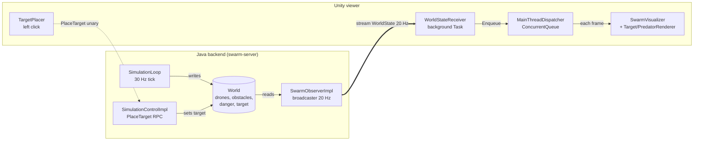
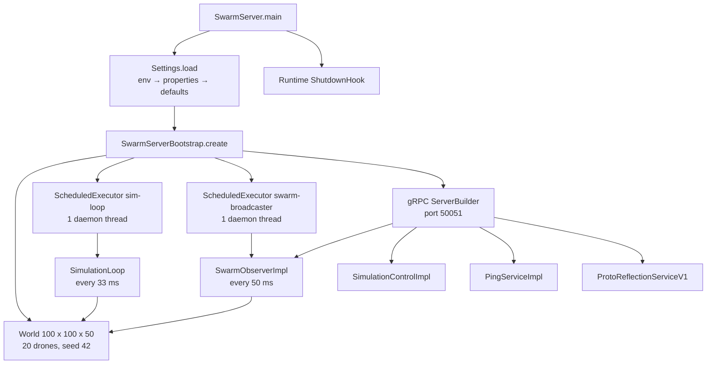
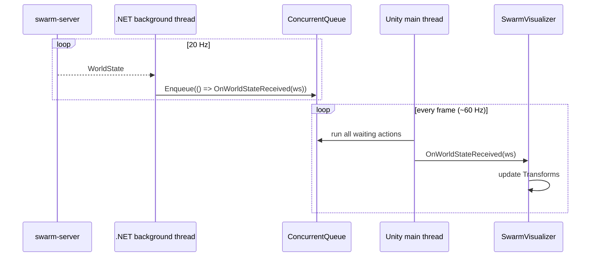

# Architecture — Gakkel swarm simulator

[Français](architecture.fr.md)

> How the Java backend and the Unity viewer work together today (end of Step 1).

---

## 1. Overview

Two independent processes talk over **gRPC**:

- **Java backend** (`swarm-server`): the only authority on the simulation. It holds the world,
  runs the Boids rules at 30 Hz and sends a `WorldState` 20 times per second.
- **Unity viewer** (`unity-client`): display only. It receives the `WorldState` and moves the
  drones on screen. It sends one command: `PlaceTarget`, when the operator clicks.



Why this split: [ADR-0001 — gRPC streaming](adr/0001-grpc-streaming.md),
[ADR-0002 — no Spring Boot](adr/0002-no-spring-boot-for-mvp.md),
[ADR-0003 — minimal 3D assets](adr/0003-minimal-3d-assets.md) and
[ADR-0006 — detailed and simple view](adr/0006-detailed-and-simple-view.md).

The operator's control station (web) will live in its own repository,
[mission-console](https://github.com/gakkel-labs/mission-console), from Step 4
([ADR-0005](adr/0005-mission-console-replaces-fleet-dashboard.md)).

---

## 2. Module layout

### Backend — Maven multi-module

Root `pom.xml` (`fr.gakkel.swarmsimulator:swarm-simulator:0.1-SNAPSHOT`, packaging `pom`) with 3 modules:

| Module          | Role                                                | Depends on     |
|-----------------|-----------------------------------------------------|----------------|
| `contracts/`    | `.proto` files + generated Java stubs (proto3)      | —              |
| `swarm-server/` | gRPC server, domain, Boids simulation loop          | `contracts`    |
| `tests/`        | End-to-end integration tests (empty for now)        | `swarm-server` |

Main versions in the root POM: Java **21**, gRPC **1.81.0**, Protobuf **3.25.5**,
JUnit **5.10.2**, Mockito **5.23.0**, SLF4J **2.0.13**, Logback **1.5.32**.

### Backend — packages

```
fr.gakkel.swarmsimulator.swarmserver
├── config         # Settings: reads env vars → application.properties → defaults, once at start
├── domain         # Agent, AgentType, World, Vector3D, Predator (the danger), Target, Obstacle,
│                  # TriggerSource, BoidsConfig, BoidsRules
├── simulation     # SimulationLoop, SimulationService, SimulationConstants, FlockingDiagnostician,
│                  # DiagnosticsConfig, CohesionMetric (sliding-window spread), CohesionCsvExporter
└── server         # SwarmServer (main), SwarmServerBootstrap (wiring), SwarmObserverImpl,
                   # SimulationControlImpl, PingServiceImpl, WorldStateBuilder, CoordinateConversions
```

`Predator` is the code name of the **danger** (see the [glossary](produit/glossaire.md));
it will be renamed.

### Unity — scripts

```
unity-client/Assets/
├── Scripts/
│   ├── Grpc/
│   │   ├── WorldStateReceiver.cs     # opens the stream, retries after 3 s if the server is down
│   │   ├── MainThreadDispatcher.cs   # ConcurrentQueue<Action>, emptied each frame
│   │   ├── TargetPlacer.cs           # left click → PlaceTarget
│   │   ├── GrpcConnectionTest.cs     # checks the server can be reached
│   │   └── Generated/                # C# code made by contracts/generate-csharp.ps1 (do not edit)
│   ├── Visualization/
│   │   ├── SwarmVisualizer.cs        # one GameObject per drone; keys V and B
│   │   ├── DetailedView.cs           # shared switch detailed / simple view (ADR-0006)
│   │   ├── TargetRenderer.cs         # the target (wreck)
│   │   ├── PredatorRenderer.cs       # the danger
│   │   ├── HydrothermalChimney.cs    # obstacles in the detailed view
│   │   ├── SeabedTerrain.cs          # real seabed from IBCAO bathymetry
│   │   ├── SeabedRocks.cs            # rocks on the seabed
│   │   ├── UnderwaterAtmosphere.cs   # fog, light, bloom
│   │   ├── CausticsTexture.cs        # light patterns on the seabed
│   │   ├── MarineSnow.cs             # particles in the water
│   │   ├── GroupDetector.cs          # finds the groups of drones for the HUD
│   │   ├── SimulationUI.cs           # text HUD
│   │   ├── CameraController.cs       # overview, follow and free cameras
│   │   └── CoordinateUtils.cs        # the only C# place that swaps axes
│   └── Rotator.cs
└── Editor/
    └── SeabedTextureImporter.cs      # import settings of the seabed textures
```

The scene is `Assets/Scenes/SampleScene.unity`. Keys and cameras:
[Unity integration §9](03-unity-integration.md#9-cameras-and-controls).
Seabed data: [seabed bathymetry](04-seabed-bathymetry.md).

---

## 3. Backend lifecycle

`SwarmServer.main()` reads the settings (`Settings.load()`) and gives them to
`SwarmServerBootstrap.create(settings)`, which builds everything.



All settings and their defaults: [README — Configuration](../README.md#configuration).

Three groups of threads work at the same time:

1. **`sim-loop`** (1 daemon thread) runs `SimulationLoop.tick()` every **33 ms**
   (`TICK_RATE_HZ = 30`). It moves the drones and the danger, and removes or adds drones.
2. **`swarm-broadcaster`** (1 daemon thread) runs `SwarmObserverImpl.broadcast()` every
   **50 ms** (`STREAM_RATE_HZ = 20`). It reads the `World`, builds the message with
   `WorldStateBuilder` and sends it to every subscriber.
3. **gRPC threads** handle the incoming calls (`SubscribeWorldState`, `PlaceTarget`, `SendPing`).

### Sharing the World between threads

No lock. Each piece of shared state uses the lightest safe tool:

- `World.agents` and `World.obstacles` are **`CopyOnWriteArrayList`**: a reader always walks a
  stable copy, even when a drone is removed at the same time.
- `World.predator` and `World.target` are `volatile`.
- `Agent.position` and `Agent.velocity` are `volatile Vector3D` (an immutable record).
- The target detection uses an `AtomicReference`: only the first drone wins.

Each drone is always whole, but one `WorldState` can mix drones from two ticks next to each
other. This is invisible at 20 Hz. Details and the limits:
[ADR-0008 — share the World without locks](adr/0008-shared-world-concurrency.md).

---

## 4. gRPC contract

All `.proto` files are in [`contracts/src/main/proto/`](../contracts/src/main/proto/).
Full reference: [gRPC contract](02-grpc-contract.md).

| Service             | RPC                       | Kind              | Role                                  | Proto package |
|---------------------|---------------------------|-------------------|---------------------------------------|---------------|
| `SwarmObserver`     | `SubscribeWorldState`     | server-streaming  | Push `WorldState` at 20 Hz            | `gakkel.swarm.v1` |
| `SimulationControl` | `PlaceTarget`             | unary             | Place the target (see ADR-0004)       | `gakkel.swarm.v1` |
| `PingService`       | `SendPing`                | unary             | Health check                          | `gakkel` |

Main messages (`swarm_observer.proto`):

```
Vec3            { float x, y, z }                          # NED, meters
AgentType       enum { UNSPECIFIED, EXPLORER, SPECIALIST, CARRIER }
AgentState      { string id (UUID), AgentType type, Vec3 position_xyz, Vec3 velocity_mps }
Obstacle        { Vec3 position_xyz, float radius_m }
PredatorState   { string id, Vec3 position_xyz, Vec3 velocity_mps }    # the danger
WorldState      { int64 timestamp_unix_ms,
                  repeated AgentState agents,
                  repeated Obstacle obstacles,
                  repeated PredatorState predators,
                  SearchStatus search_status,
                  float sensor_radius_m,
                  float cohesion_spread_m }
SearchStatus    { bool target_placed, Vec3 target_position,
                  float elapsed_sim_s, TargetFoundEvent found_event }
```

### Coordinate frames

The backend, the wire and Unity do **not** use the same axes:

| | X | Y | Z |
|---|---|---|---|
| Backend | East | Up | North |
| Contract (NED) | North | East | Down |
| Unity | East | Up | North |

Each side converts in one place only: `CoordinateConversions` in Java, `CoordinateUtils` in C#.
Details: [ADR-0007 — coordinate frames](adr/0007-coordinate-frames.md).

---

## 5. The simulation tick

```mermaid
sequenceDiagram
    participant Exec as sim-loop executor
    participant Loop as SimulationLoop
    participant Rules as BoidsRules
    participant World as World
    participant Danger as Predator (danger)

    loop every 33 ms
        Exec->>Loop: tick()
        Loop->>World: copy the drone list
        Loop->>Rules: steer(drone, neighbours, world) for each drone
        Rules-->>Loop: sum of the 7 rules
        Loop->>World: move each drone (speed limit, obstacles, walls)
        Loop->>Danger: update, try to catch a drone (respawn after 5 s)
        Loop->>World: check target detection (sensor radius 10 m)
        Loop->>Loop: cohesion metric, CSV every 1 s, diagnostics every 5 s
    end
```

All forces are computed from the same copy before any drone moves, so the order of the drones
does not change the result. Details: [`SimulationLoop.java`](../swarm-server/src/main/java/fr/gakkel/swarmsimulator/swarmserver/simulation/SimulationLoop.java)
and the [Boids rules](01-boids-rules.md).

---

## 6. The Unity side (threads)

Unity lets **only the main thread** touch the scene. The gRPC stream arrives on a .NET
background thread, so a bridge is needed. Full pattern:
[Unity integration](03-unity-integration.md).



If the server goes down (`StatusCode.Unavailable`), the receiver tries again after 3 s.

---

## 7. Frequencies

| Loop                                       | Frequency | Period   | Thread                          |
|--------------------------------------------|-----------|----------|---------------------------------|
| `SimulationLoop.tick`                      | 30 Hz     | 33 ms    | `sim-loop` (1 daemon)           |
| `SwarmObserverImpl.broadcast`              | 20 Hz     | 50 ms    | `swarm-broadcaster` (1 daemon)  |
| Unity `MainThreadDispatcher`               | ~60 fps   | ~16 ms   | Unity main thread               |

The simulation runs on the computer clock for now. A simulation clock (`step(dt)`), needed for
repeatable runs, is planned for Step 2.

---

## 8. Going further

- [ADR-0001 — gRPC streaming](adr/0001-grpc-streaming.md)
- [ADR-0002 — no Spring Boot for the MVP](adr/0002-no-spring-boot-for-mvp.md)
- [ADR-0003 — minimal 3D assets](adr/0003-minimal-3d-assets.md)
- [ADR-0004 — operator-triggered target placement](adr/0004-target-placement-operator-triggered.md)
- [ADR-0005 — mission-console](adr/0005-mission-console-replaces-fleet-dashboard.md)
- [ADR-0006 — detailed and simple view](adr/0006-detailed-and-simple-view.md)
- [ADR-0007 — coordinate frames](adr/0007-coordinate-frames.md)
- [ADR-0008 — share the World without locks](adr/0008-shared-world-concurrency.md)
- [Boids rules](01-boids-rules.md) · [gRPC contract](02-grpc-contract.md) ·
  [Unity integration](03-unity-integration.md) · [Seabed bathymetry](04-seabed-bathymetry.md)
- [Tech debt, 2026-11-22](tech-debt/tech-debt-2026-11-22.md) (earlier snapshots: [2026-05-21](tech-debt/tech-debt-2026-05-21.md), [2026-05-25](tech-debt/tech-debt-2026-05-25.md), French only)
